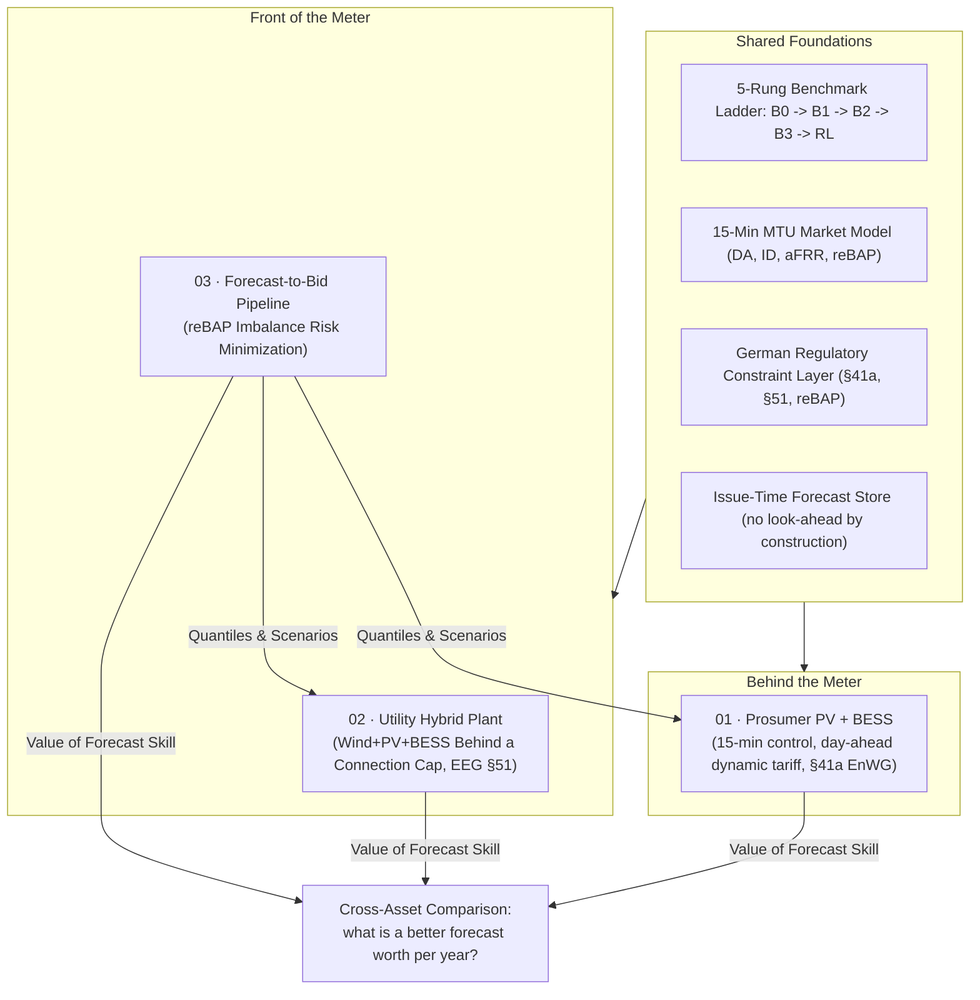

# ⚡ AI for Renewable Energy Systems: Applied Research Portfolio

> Three engineering research projects applying **reinforcement learning, model predictive control, mathematical optimization (MILP), and probabilistic forecasting** to European power systems: strictly grounded in actual German market designs, grid codes, and regulatory frameworks.

[](https://www.python.org/downloads/)
[](https://muratkus01.github.io/Portfolio/showcase.html)
[](https://github.com/muratkus01/Portfolio/actions/workflows/tests.yml)
[](docs/05-tech-stack.md)
[](LICENSE)

**Author:** Murat Kus · Dipl.-Ing. Mechanical Engineering · M.Sc. Sustainable Energy Systems (FH Upper Austria) · B.Sc. Artificial Intelligence (JKU Linz) - In Progress  
**Domain:** Power System Economics, Energy Market Optimization, Sequential Decision-Making under Uncertainty  
**Focus Markets:** Germany (DE-LU bidding zone), EPEX SPOT Day-Ahead / Intraday (SDAC/SIDC), `regelleistung.net` Balancing (FCR/aFRR), and German **reBAP** Imbalance Settlement.

---

## 🎯 60-Second Executive Quickstart

### 🌐 Interactive Web Showcase
Simulate the full 1,082-scenario parameter grid across the three projects with live sensitivity sweeps and 15-minute dispatch profiles directly in your browser:  
👉 **[muratkus01.github.io/Portfolio/showcase.html](https://muratkus01.github.io/Portfolio/showcase.html)**

### 💻 Local Execution
Run the master interactive showcase dashboard to simulate live benchmarks across the three projects:

```bash
# Clone and install the three packages in editable mode
git clone https://github.com/muratkus01/Portfolio.git
cd Portfolio
pip install -e projects/01-prosumer-pv-bess-mpc-rl -e projects/02-utility-hybrid-plant-dispatch -e projects/03-probabilistic-forecast-to-bid

# Run the Master Showcase Runner
python showcase.py

# Run all unit tests across the portfolio
pytest -v
```

---

## 🚀 The Three Portfolio Projects

Each project is a fully structured Python package with clean modular `src/`, reproducible unit test suite in `tests/`, and CLI execution tools:



---

### Project Breakdown & CLI Quickstarts

| # | Project Dossier | Core Method | Asset / Scale | Regulatory Framework | Quickstart Command |
|:---:|---|---|---|---|---|
| **01** | [**Prosumer PV+BESS Energy Management**](projects/01-prosumer-pv-bess-mpc-rl/) | Fast LP-MPC + Rescaled SAC RL | 8 kWp PV, 9.37 kWh BESS, 5.63 kW Inverter | §14a / §41a EnWG, EEG 2023 | `prosumer rolling-eval` |
| **02** | [**Utility Hybrid Wind+PV+BESS Plant**](projects/02-utility-hybrid-plant-dispatch/) | Co-located LP + B3 Rolling MPC | 50 MW Wind, 30 MW PV, 40 MWh BESS | EEG §51 / §51a Negative Price Rules | `python -m hybrid.cli ladder` |
| **03** | [**Probabilistic Forecast-to-Bid**](projects/03-probabilistic-forecast-to-bid/) | Quantile Loss + Newsvendor Fractile | 300 MW Portfolio | SIDC Intraday, German reBAP | `python -m f2b.cli policies` |

**Scope decision, 2026-10-09.** The portfolio was narrowed from six projects to three, so that each
one can be defended in depth rather than listed. Pumped-storage multi-market dispatch, smart EV
charging under §14a EnWG, and cooperative energy sharing in renewable energy communities moved to
[`archive/`](archive/). They still build, and their 88 tests still run in CI. See
[`archive/README.md`](archive/README.md) for what each one established and why it was set aside.

---

## 🛡️ Bugs the Invariants Caught

Every project asserts structural physical, electrical, and market invariants at runtime. Each invariant caught a real defect that would otherwise have produced plausible but invalid optimization results:

| Project | Invariant | What It Caught |
|:---:|---|---|
| **01** | B2 <= B3 <= B1; zero violations under random actions | Linear terminal storage valuation priced stored energy at full retail import, driving MPC to buy from the grid at every horizon boundary. Continuous action clipping truncated policy outputs at 80% (resolved via action rescaling). |
| **02** | Zero violations; B2 >= B3 >= B1; symmetrical reservation | Reservoir bounds overrode ramp limits during overtopping (resolved by modeling spill). Continuous LP permitted fractional concurrent turbining and pumping to slip past ramp limits (resolved by binary mode mutual exclusion). Capacity sold in aFRR auctions was omitted from heuristics, letting baselines trade through reserved headroom. |
| **03** | Zero missed declared departures | Per-connector feasibility checks failed to detect collective contention: the price-aware policy missed 108 departures until the Earliest Deadline First (EDF) aggregate floor was implemented. Truncating boundary arrivals at horizon termination falsely scored uncompleted visits as misses (resolved via right-censoring). |
| **04** | Core non-emptiness & individual rationality | Coalition value formulation previously mixed retail import savings with operator feed-in revenue; correcting the cooperative surplus proved cooperation remains viable up to a 0.110 EUR/kWh network charge. |
| **02** | B3 >= B1; every rung <= perfect foresight | B3 applied a planned curtailment fraction from forecast generation to actual generation, discarding deliverable energy. Voluntarily gating curtailment to negative prices lifted B3 to +5.4% over the unhybridized plant. |
| **03** | Lookahead audit clean; monotonic quantiles | Test fixtures previously shared stateful RNG instances between forecast synthesis and evaluation. Adding strict `IssueTimeStore` prevents any feature from leaking future market states. |

---

## 📐 Methodological Spine: The 5-Rung Benchmark Ladder

Every project enforces the same rigorous evaluation protocol:

| Rung | Controller | Purpose & Criterion |
|:---:|---|---|
| **B0** | Historical / Status-Quo | Baseline uncoordinated or unhedged reference. |
| **B1** | Rule-Based Expert Baseline | Industry-standard heuristic (e.g. greedy self-consumption, threshold shaving). |
| **B2** | Perfect-Foresight Optimization | Theoretical performance ceiling over the entire simulation horizon. |
| **B3** | Rolling-Horizon MPC | **The deployable classical benchmark** operating under imperfect lookahead. |
| **RL** | Learned Policy (PPO / SAC) | **Must beat B3 on out-of-sample data** to justify algorithmic deployment. |

---

## 📂 Repository Structure

```
Portfolio/
├── pyproject.toml                     ← Global multi-project test runner configuration
├── showcase.py                        ← Master terminal showcase dashboard
├── README.md                          ← You are here
├── HANDOFF.md                         ← Durable session state & dual-assistant memory
├── CLAUDE.md                          ← Assistant instructions & quickstart guide
├── datakit/                           ← Shared market data loaders & spot price connectors
├── docs/                              ← Energy market primers, regulatory guides & math
├── projects/                          ← The three active projects (218 tests)
│   ├── 01-prosumer-pv-bess-mpc-rl/    ← Package: prosumer (174 tests; data tests skip without the gitignored data)
│   ├── 02-utility-hybrid-plant-dispatch/ ← Package: hybrid (26 tests)
│   └── 03-probabilistic-forecast-to-bid/ ← Package: f2b (18 tests)
└── archive/                           ← Set aside 2026-10-09, still tested (88 tests)
    ├── 02-pumped-storage-rl-multimarket/ ← Package: psw (27 tests)
    ├── 03-smart-ev-charging-14a/      ← Package: evc (20 tests)
    └── 04-energy-sharing-rec/         ← Package: rec (41 tests)
```

---

## 📜 Citation & License

This project is licensed under the [MIT License](LICENSE).  
If you use this portfolio or its formulations in academic research, please cite using [CITATION.cff](CITATION.cff).
