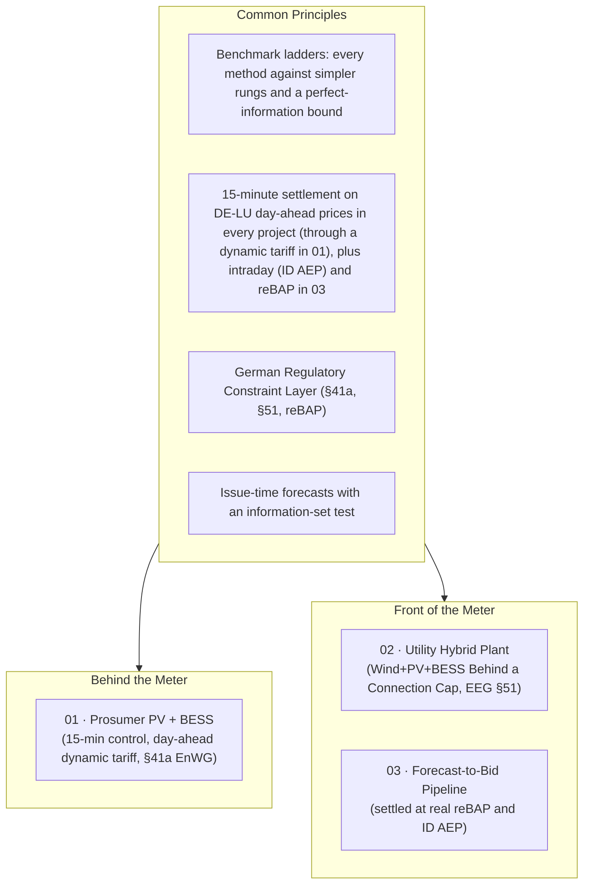

# ⚡ AI for Renewable Energy Systems: Applied Research Portfolio

> Three engineering research projects applying **reinforcement learning, model predictive control, mathematical optimization (MILP), and probabilistic forecasting** to European power systems: strictly grounded in actual German market designs, grid codes, and regulatory frameworks.

[](https://www.python.org/downloads/)
[](https://muratkus01.github.io/Portfolio/showcase.html)
[](https://github.com/muratkus01/Portfolio/actions/workflows/tests.yml)
[](docs/05-tech-stack.md)
[](LICENSE)

**Author:** Murat Kus · Dipl.-Ing. Mechanical Engineering · M.Sc. Sustainable Energy Systems (FH Upper Austria) · B.Sc. Artificial Intelligence (JKU Linz) - In Progress  
**Domain:** Power System Economics, Energy Market Optimization, Sequential Decision-Making under Uncertainty  
**Focus Markets:** Germany (DE-LU bidding zone): EPEX SPOT Day-Ahead (SDAC), continuous Intraday (SIDC, at the ID AEP index), German **reBAP** Imbalance Settlement, and EEG direct marketing with the market premium. No active project models balancing reserve (FCR/aFRR) yet; aFRR for Project 02's battery is planned next.

---

## 🎯 60-Second Executive Quickstart

### 🌐 Interactive Web Showcase
Explore the three projects' results, sensitivity sweeps and 15-minute dispatch profiles directly in your browser:  
👉 **[muratkus01.github.io/Portfolio/showcase.html](https://muratkus01.github.io/Portfolio/showcase.html)**

### 💻 Local Execution
Run the terminal showcase. It reruns the Project 01 and 02 benchmark ladders on synthetic inputs and does not recompute Project 03, whose results are the committed CSVs in its `reports/` folder:

```bash
# Clone and install the three packages in editable mode
git clone https://github.com/muratkus01/Portfolio.git
cd Portfolio
pip install -e projects/01-prosumer-pv-bess-mpc-rl -e projects/02-utility-hybrid-plant-dispatch -e projects/03-probabilistic-forecast-to-bid

# Run the Master Showcase Runner
python showcase.py

# Run all unit tests across the portfolio
pytest -v
```

---

## 🚀 The Three Portfolio Projects

Each project is a fully structured Python package with clean modular `src/`, reproducible unit test suite in `tests/`, and CLI execution tools:



---

### Project Breakdown & CLI Quickstarts

| # | Project Dossier | Core Method | Asset / Scale | Regulatory Framework | Quickstart Command |
|:---:|---|---|---|---|---|
| **01** | [**Prosumer PV+BESS Energy Management**](projects/01-prosumer-pv-bess-mpc-rl/) | Fast LP-MPC + Rescaled SAC RL | 8 kWp PV, 9.37 kWh BESS, 5.63 kW Inverter | §14a / §41a EnWG, EEG 2023 | `prosumer rolling-eval` |
| **02** | [**Utility Hybrid Wind+PV+BESS Plant**](projects/02-utility-hybrid-plant-dispatch/) | Benchmark ladder from B0 (no battery) to B3, an LP rolling MPC on synthetic forecasts; whole-run negative-price rules per EEG vintage, and the market premium computed per technology against its market value. Stops at B3 by design | 50 MW onshore wind + 30 MWp PV + 20 MW / 40 MWh battery behind one 60 MW connection; national capacity factors, not a real site | EEG §51 negative-price rule by vintage, EEG 2023 market premium | `python -m hybrid.cli ladder --year 2025 --start 01-01 --days 30` |
| **03** | [**Probabilistic Forecast-to-Bid**](projects/03-probabilistic-forecast-to-bid/) | Quantile forecast ladder (climatology to LightGBM, TSO forecast as benchmark), settled at real day-ahead, intraday (ID AEP) and reBAP prices | 200 MW wind + 100 MW PV, fleet-shaped | German single-price reBAP | `python -m f2b.cli backtest --phase validation` |

Project 03's backtest needs the `[forecast]` extra (LightGBM, SciPy) and one `python -m f2b.cli build-data` run first. For its euro results, download reBAP and ID AEP by hand from netztransparenz.de into its `data/raw/netztransparenz/` folder before that run, because `build-data` reads them into the dataset ([its README](projects/03-probabilistic-forecast-to-bid/README.md), section 6).

**Scope decision, 2026-10-09.** The portfolio was narrowed from six projects to three, so that each
one can be defended in depth rather than listed. Pumped-storage multi-market dispatch, smart EV
charging under §14a EnWG, and cooperative energy sharing in renewable energy communities moved to
[`archive/`](archive/). They still build, and their 88 tests still run in CI. See
[`archive/README.md`](archive/README.md) for what each one established and why it was set aside.

---

## 🛡️ Bugs the Invariants Caught

Every project checks structural physical, electrical, and market invariants, at runtime or in its tests. Each invariant caught, or now guards against, a real defect that would otherwise have produced plausible but invalid results:

| Project | Invariant | What It Caught |
|:---:|---|---|
| **01** | B2 <= B3 <= B1; zero violations under random actions | Linear terminal storage valuation priced stored energy at full retail import, driving MPC to buy from the grid at every horizon boundary. Continuous action clipping truncated policy outputs at 80% (resolved via action rescaling). |
| **02** | No rung beats perfect foresight (B2) on revenue before imbalance, beyond solver rounding (`run_ladder` raises); zero violations under random actions; regression tests against the statute and the settlement | Found in the rebuild, each now pinned by a test. The six-hour rule kept the premium for the first 23 quarter-hours of a negative-price run, where §51 removes it for the whole run; a test had pinned the wrong rule, and that test, `test_six_hour_rule_removes_the_premium_for_the_whole_run`, now pins the statute's. Imbalance was never settled, because `run_ladder` dropped the schedule whenever reBAP was given (`test_a_deviation_from_the_committed_schedule_is_settled_at_rebap`; no rung commits a schedule yet, so imbalance is still 0 in every table). Grid imports were free: a stand-in rung that bought grid energy and sold it back beat B2 and tripped the ladder invariant (`test_grid_imports_are_paid_at_the_day_ahead_price`). Every battery rung started half full, so the battery sold energy it never bought and counted it as its value (`test_no_rung_earns_from_energy_it_never_bought`). The invariant's absolute 1e-3 EUR tolerance tripped on solver rounding when B3 matched B2 under perfect forecasts; it is now 1e-6 of B2 (`test_perfect_forecasts_do_not_trip_the_ladder_invariant`). The premium came from the window's plain mean price instead of each technology's market value, so B3 planned on prices it had not reached yet (`test_later_prices_do_not_change_b3s_earlier_decisions`). |
| **03** | No forecast read after its decision time (an audit that can fail); features unchanged when everything outside their information set is corrupted | The information-set test caught a PV feature that wrapped around to the end of the series on the first day. Found during the rebuild and now guarded by the audit and its tests: day-ahead positions read forecasts issued after the 12:00 gate closure for every quarter-hour delivered after noon, and the old audit only re-checked the store's own guard, so it could not fail. The rebuild also found that the old model set the intraday price equal to the day-ahead price. |

The archived projects ([`archive/README.md`](archive/README.md)) carry the number of their folder, prefixed with A:

| Archived | Invariant | What It Caught |
|:---:|---|---|
| **A2** · pumped storage | Zero violations; B2 >= B3 >= B1; symmetrical reservation | Reservoir bounds overrode ramp limits during overtopping (resolved by modeling spill). Continuous LP permitted fractional concurrent turbining and pumping to slip past ramp limits (resolved by binary mode mutual exclusion). Capacity sold in aFRR auctions was omitted from heuristics, letting baselines trade through reserved headroom. |
| **A3** · EV charging | Zero missed declared departures | Per-connector feasibility checks failed to detect collective contention: the price-aware policy missed 108 departures until the Earliest Deadline First (EDF) aggregate floor was implemented. Truncating boundary arrivals at horizon termination falsely scored uncompleted visits as misses (resolved via right-censoring). |
| **A4** · energy sharing | Core non-emptiness & individual rationality | Coalition value formulation previously mixed retail import savings with operator feed-in revenue; correcting the cooperative surplus proved cooperation remains viable up to a 0.110 EUR/kWh network charge. |

---

## 📐 Methodological Spine: Benchmark Ladders

Every method is measured against simpler rungs on the same data and against a perfect-information bound. Projects 01 and 02 climb a controller ladder:

| Rung | Controller | Purpose & Criterion |
|:---:|---|---|
| **B0** | Historical / Status-Quo | Baseline uncoordinated or unhedged reference. |
| **B1** | Rule-Based Expert Baseline | Industry-standard heuristic (e.g. greedy self-consumption, threshold shaving). |
| **B2** | Perfect-Foresight Optimization | Theoretical performance ceiling over the entire simulation horizon. |
| **B3** | Rolling-Horizon MPC | **The deployable classical benchmark** operating under imperfect lookahead. |
| **RL** | Learned Policy (SAC, Project 01 only) | **Must beat B3 on out-of-sample data** to justify algorithmic deployment. |

Project 03 climbs a forecast ladder instead: climatology, persistence, linear quantile regression and LightGBM, with the forecast the transmission system operators publish as a benchmark. Every forecast is traded by the same policy rules (day-ahead only, intraday to the median, and a deadband rule whose band is tuned per forecast on the validation window) and compared with the perfect forecast.

---

## 📂 Repository Structure

```
Portfolio/
├── pyproject.toml                     ← Global multi-project test runner configuration
├── showcase.py                        ← Master terminal showcase dashboard
├── README.md                          ← You are here
├── HANDOFF.md                         ← Durable session state & dual-assistant memory
├── CLAUDE.md                          ← Assistant instructions & quickstart guide
├── datakit/                           ← Shared market data loaders & spot price connectors
├── docs/                              ← Energy market primers, regulatory guides & math
├── projects/                          ← The three active projects (428 tests)
│   ├── 01-prosumer-pv-bess-mpc-rl/    ← Package: prosumer (187 tests; data tests skip without the gitignored data)
│   ├── 02-utility-hybrid-plant-dispatch/ ← Package: hybrid (180 tests, all offline)
│   └── 03-probabilistic-forecast-to-bid/ ← Package: f2b (61 tests)
└── archive/                           ← Set aside 2026-10-09, still tested (88 tests)
    ├── 02-pumped-storage-rl-multimarket/ ← Package: psw (27 tests)
    ├── 03-smart-ev-charging-14a/      ← Package: evc (20 tests)
    └── 04-energy-sharing-rec/         ← Package: rec (41 tests)
```

Test counts as `pytest --collect-only` gave them on 2026-11-01: 516 in all. Without the gitignored data, the full suite gave 476 passed and 40 skipped, all 40 of them Project 01's data tests; CI, which does not install LightGBM, skips one more.

---

## 📜 Citation & License

This project is licensed under the [MIT License](LICENSE).  
If you use this portfolio or its formulations in academic research, please cite using [CITATION.cff](CITATION.cff).
