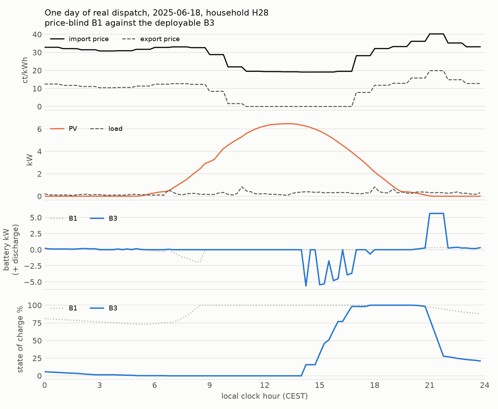
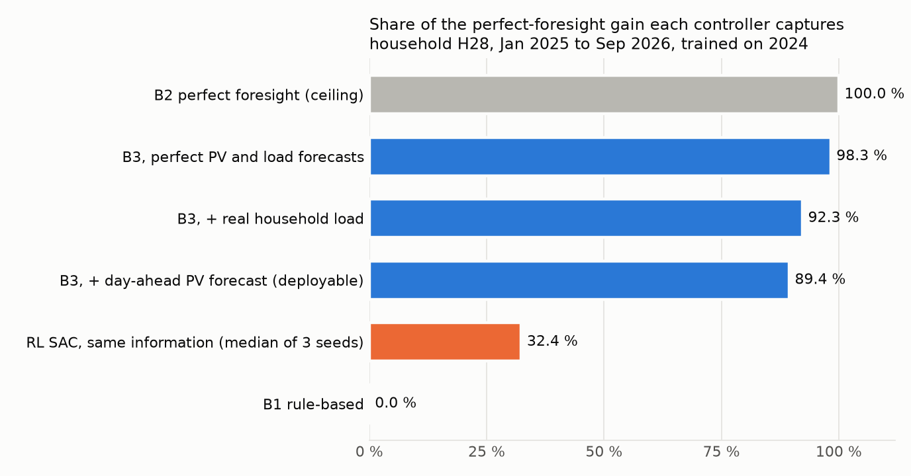
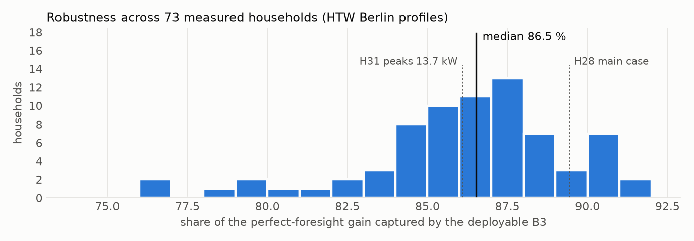
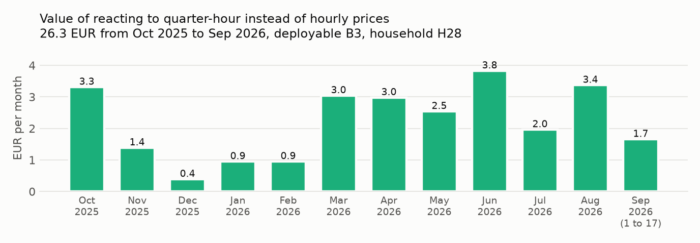
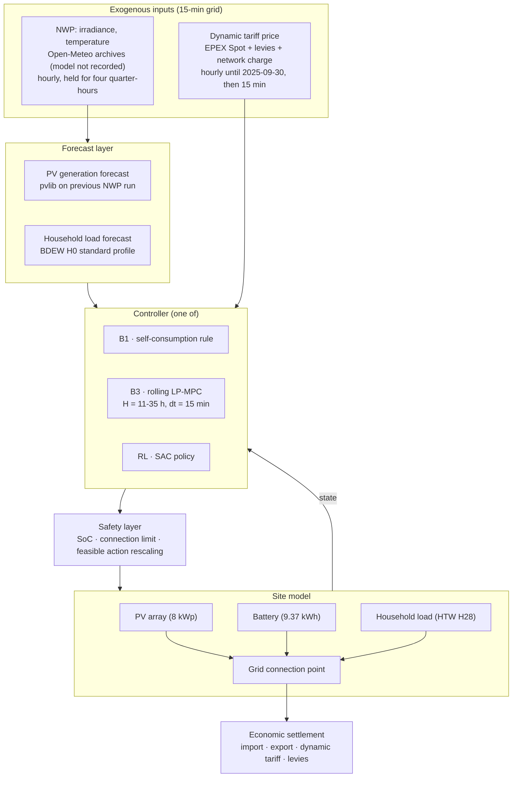

# Project 01 · Prosumer PV + Battery Energy Management at 15-Minute Resolution

**Rolling-horizon LP-MPC and reinforcement learning for a German residential prosumer site with 8 kWp PV and 9.37 kWh battery storage, controlled every 15 minutes under a day-ahead-indexed dynamic tariff (`§41a EnWG`; hourly day-ahead products until 2025-09-30, quarter-hour products after) and realistic forecast information sets.**

| | |
|---|---|
| **Status** | **Implemented and evaluated** on 2025/2026 out-of-sample data, 73 measured households |
| **Type** | Extension of the author's M.Sc. thesis ([`muratkus01/optimization`](https://github.com/muratkus01/optimization), tag `thesis-v1.0`) |
| **Method** | Rolling-horizon LP-MPC on a realistic information set · Soft Actor-Critic with a safety layer |
| **Asset** | 8 kWp PV, 9.37 kWh battery (5 to 95 % usable), 5.63 kW inverter: the thesis household (`thesis.THESIS_SITE`). Gate 0 runs it in the thesis configuration; every dispatch result of the thesis extension runs it through `scenarios.EXTENSION_RUN` (the sizing grid changes only the battery and inverter size). Only section 0 (earlier results on four measured weeks) ran on the `SiteConfig()` defaults instead: 8.9 kWh, 5.51 kW, 0.95 efficiency each way, close to the MaStR mean German home storage of January 2024 (8.96 kWh / 5.53 kW). |
| **Resolution** | **15 min**, including the quarter-hour day-ahead market since 2025-10-01 |
| **Horizon** | Until the last published price: 11 to 35 h (re-solved every 15 min) |

---

## Thesis extension: results

The thesis optimised one household over 2024 at hourly resolution with perfect foresight.
This extension asks what a controller that could actually be deployed achieves, and what the
switch of the EPEX day-ahead market to quarter-hour products on 1 October 2025 is worth.
The main results below come from committed scripts and committed CSVs in `reports/` (for
Gate 0, a committed test and its reference CSV). Each CSV's commit is in
`git log -- reports/`, and [`tests/test_readme_results.py`](tests/test_readme_results.py)
checks the numbers this page takes from them. Solve times and a few supporting checks come
from one-off runs; the checks are marked. The example-day numbers and the spread of the RL
step cost come from the scripts in [`scripts/`](scripts/), which need the gitignored H28
dataset.

```bash
pip install -e ".[rl,data,dev]"
prosumer build-data                         # load, PV, PV forecast, prices 2024-2026 on a 15-min grid
prosumer rolling-eval --data <household>    # B1 / B2 / B3 variants, train 2024, test 2025-2026
prosumer household-sweep                    # the deployable B3 for 73 measured households
prosumer quarter-hour-study                 # value of quarter-hour prices after 2025-10-01
prosumer rl-eval                            # SAC on the same information set as B3
prosumer year-split                         # 2025 against 2026 over the same months, from the CSVs
prosumer sizing                             # battery capacity x inverter power grid sweep
```

### Gate 0: the published thesis is reproduced

`tests/test_thesis_reproduction.py` runs the three thesis scenarios (PV only, rule-based,
perfect-foresight MILP over 2024) on this package's own controllers and matches all 25
published yearly figures of each scenario within 0.01 EUR. The retail tariff was recovered
from the published data exactly: `EP_buy = 1.19 * EPEX + 0.1937`,
`EP_sell = max(0, 1.19 * EPEX - 0.01)` EUR/kWh.

**Found while validating:** the thesis PV profile is one hour early, which
`tests/test_thesis_reproduction.py` checks. Its source, a company ERA5 model export with
UTC timestamps, is centred on solar noon; during data preparation the timestamps were
written into the CET column one to one (under that reading the two series are identical in
almost every hour). These two statements about the export rest on a one-off comparison
with it, which cannot be redistributed, so no test repeats them. Correcting the timing
(`load_thesis_year(correct_pv_timing=True)`) lowers the optimised scenario's annual profit
by about 2 % (1039.0 to 1018.2 EUR, a one-off rerun that no test covers yet); the thesis
conclusions hold. The thesis data is kept as published so Gate 0 still reproduces it;
everything new uses correctly timed PV.

### Data, 2024 to 2026, on a 15-minute grid

| Input | Source | Check |
|---|---|---|
| Prices | EPEX DE-LU day-ahead, Energy-Charts | the 2024 prices equal the thesis prices in all 8,784 hours when the thesis labels are read as CET (UTC+1) ([test](tests/test_data_2024_2026.py)); hourly products until 2025-09-30, quarter-hour after |
| PV | pvlib on Open-Meteo 15-min weather, loss calibrated to the thesis 2024 yield | daily correlation with the thesis PV in 2024: 0.95 (one-off check) |
| PV forecast | the same model on the hourly weather forecast issued a day earlier (Open-Meteo previous runs) | nRMSE (RMSE over mean PV, quarter-hours with PV above 0.05 kW) 0.30 to 0.38 per year 2024 to 2026, bias within 1.5 % (one-off check) |
| Load | 74 measured households, HTW Berlin (Tjaden et al. 2015), scaled to 3221 kWh/a and replayed on the 2024 to 2026 calendar on the households' own clock (legal local time) | one household shows PV behind the meter and is excluded ([screen](reports/htw_pv_screen.csv)) |
| Load forecast | BDEW H0 standard profile with Bavarian holidays | nRMSE at 15 min, RMSE over mean load, 2024 to 2026: 0.82 for H28, 1.02 for H31 (one-off check) |

### Master benchmark comparison: 20.5-month out-of-sample evaluation

Full benchmark ladder evaluated on household H28 (3,221 kWh/a, 8 kWp PV, 9.37 kWh battery, 5.63 kW inverter) across the out-of-sample test period from 2025-01-01 to 2026-09-17 (625 days, 59,996 decision steps at 15-minute resolution). Every result over this period averages two market designs: the day-ahead price is hourly, held over four quarter-hours, on the first 273 days (26,204 steps, until 2025-09-30) and quarter-hourly on the last 352 (33,792 steps; `price_mtu_min` in the dataset). None of these results is split by market design. The 2024 training year, which sets B3's terminal values and trains the RL agent, has hourly prices only; what that does to the results after the switch was not measured. Net costs are negative (net export revenue exceeds import cost).

| Rung | Controller | Net Cost (20.5m) | Net Cost (€/a) | Headroom % | Annual Cycles | Violations | Mean Solve | Payback | ROCE |
|---|---|---:|---:|---:|---:|---:|---:|---:|---:|
| **B0** | PV only (no battery baseline) | +90.56 € | +52.89 € | - | 0.0 | 0 | - | - | - |
| **B1** | Rule-based self-consumption | -324.98 € | -189.80 € | 0.0 % (B1 ref) | 168.9 | 0 | < 1 ms | 17.9 yr | 5.6 % |
| **B2** | Perfect foresight LP | -716.68 € | -418.57 € | 100.0 % | 298.2 | 0 | 4.2 s (yr) | 9.2 yr | 10.8 % |
| **B3** | Deployable rolling MPC (realistic) | -675.27 € | -394.38 € | **89.4 %** | 287.5 | 0 | 5.9 ms ¹ | **9.7 yr** | **10.3 %** |
| **RL** | Overhauled SAC (rescaled action, diff reward), seed 1, the median of 3 seeds by capture | -451.82 € | -263.88 € | **32.4 %** | 267.8 | 0 | 1.2 ms | **13.7 yr** | **7.3 %** |

¹ Solve time measured on an idle machine before the clock fix; the rerun CSV shows 19.5 ms because eight jobs shared four cores. The fix does not touch the controller.

- **B3 Headroom Recovery:** The deployable rolling MPC captures **89.4 %** of the theoretical perfect-foresight ceiling (350 of 392 EUR headroom over B1) using only published prices, NWP irradiance forecasts, and standard load profiles. Zero constraint violations across all 59,996 quarter-hours.
- **Economic Return:** Adding a battery under B3 dispatch turns an annual electricity expense of +52.89 EUR/a (PV only) into a net revenue of -394.38 EUR/a, an annual gain of **447.27 EUR/a**. Against the marginal CAPEX of 4,349 EUR (350 EUR/kWh storage plus 190 EUR/kW inverter) that is a **9.7-year simple payback** and **10.3 % return on capital**, against 17.9 years and 5.6 % for the price-blind rule-based operation. Perfect foresight would reach 9.2 years and 10.8 %, so the entire remaining control gap is worth about half a point of return.

#### The same months in 2025 and 2026

The test period holds January to September twice: in 2025 with hourly day-ahead prices, in
2026 with quarter-hour prices and only until 17 September. Over those months the B1 to B2
gap is 157 EUR in 2025 and 217 EUR in 2026, and B3 captures 87.2 % and 92.7 % of it. The
three RL seeds capture 27.8 to 29.2 % in 2025 and 49.5 to 50.6 % in 2026, and over the whole
of 2025 only 9.7 to 10.2 % (B3: 85.4 %). Every RL seed costs more than B1 in each of the 7
months from October to February (January and February 2025, October 2025 to February 2026)
and less in each of the other 14; B3 costs less than B1 in all 21 months. The split cannot
separate the market design from the year. `prosumer year-split` computes it from the monthly
cost CSVs of the H28 rolling evaluation and the RL run
([year_split](reports/year_split/year_split.csv)).

### Operational dispatch: 24-hour summer day comparison

The figure below isolates the physical dispatch of the price-blind rule-based heuristic (B1) against the price-aware rolling-horizon MPC (B3) over a 24-hour summer period:



This is a real run of both controllers, warmed up over the three preceding days, on the
project's own tariff ([`scripts/example_day_stats.py`](scripts/example_day_stats.py) prints
every number below). On this day the export price falls to **0 ct/kWh between 11:00 and
17:00** (16 quarter-hours of negative spot price, which are four hourly products: the day
predates the quarter-hour day-ahead market), while the evening peak reaches **40 ct/kWh**
around 21:00.

- **Morning (06:00 to 11:00).** B1 charges on the first PV surplus and is full by 08:30. B3
  leaves the battery empty: it entered the day at 6 % and is at 0.2 % or less from 06:00 to
  11:00, because surplus in the morning is still worth 12 ct/kWh on export while the
  evening peak is worth far more to displace.
- **Midday (11:00 to 17:00).** B1 is already full and exports 46.0 kWh over the day, of
  which **33.0 kWh earn nothing at all**. B3 waits until the export price has collapsed to
  zero and charges almost only then: 8.8 kWh of otherwise worthless surplus, and a last
  0.2 kWh at 17:45, when it reaches full charge. Its zero-price export is 24.3 kWh, about a
  quarter less than B1's.
- **Evening (18:00 to 23:00).** B3 discharges 6.1 kWh into the expensive hours, at up to the
  full 5.63 kW inverter rating during the 40 ct peak. B1, having spent the day full and
  trickled into its own base load, contributes only 0.8 kWh there.
- **Neither controller charges from the grid**, not even in the negative-price hours: the
  retail import price never drops below 19 ct/kWh, since taxes, levies and network charges
  dominate the spot component. Grid arbitrage does not pay for a German household.
- **Result for the day:** -1.76 EUR for B3 against -0.75 EUR for B1 (negative is revenue,
  battery wear included), a difference of about 1 EUR on a single summer day. It is earned
  by *when* the battery is used, which also lets B3 use it more: B3 discharges 6.8 kWh over
  the day, B1 1.7 kWh.

### How much of the perfect-foresight gain does a deployable controller capture?

The controller re-plans every quarter-hour. Day D+1 prices become known at 13:00 on day D,
and the window ends at the last published price. Stored energy at the window end is valued
with a monthly price learned on 2024 from the perfect-foresight LP's shadow prices, so no
information from the test period is used.



For the most typical household (H28, closest to the median of all 73 on five load-shape
features), the deployable B3 captures **89.4 %** of the gain that perfect foresight would
achieve over the rule-based controller, 350 of 392 EUR over 20.5 months (hourly day-ahead
prices until 2025-09-30, quarter-hour prices after). The gap
decomposes cleanly: the price-limited horizon costs about 2 points, the household's load
not following the standard profile about 6, and PV forecast error about 3. Zero
constraint violations in every run.



Across all 73 measured households the deployable B3 captures a median **86.5 %** (middle
half 84.8 to 88.3 %, range 76.8 to 91.2 %). The clock fix moved the median by +1.3 points
(85.2 % before), H28 by +1.5 and H31 by +1.3, and no household by more than +3.6 or
-1.8, so the ranking of households is essentially unchanged. Households with high peaks
capture less: H31, likely with an instantaneous electric water heater, reaches 97.9 % with
perfect forecasts, 88.8 % with the standard-profile load forecast and 86.1 % as deployed,
with the PV forecast as well.

### What is the quarter-hour day-ahead market worth?

On the period after the switch, the same controller either sees the real quarter-hour
prices or their hourly means, and both are settled at the real quarter-hour prices.



Reacting to quarter-hour prices is worth **26.3 EUR** to the deployable B3 over the 352
days from 2025-10-01 to 2026-09-17, about 27 EUR/a if scaled pro rata to a full year
(22.7 EUR over the 352 days with perfect foresight). That is 11.2 % of the whole
optimisation gain (B1 to B2) over the same days (9.6 % with perfect foresight). It is earned
mostly from March to October. The standard-profile household gives nearly the same values
(24.9 and 22.3 EUR over the 352 days). An hourly model of the same household, as in the
thesis, overstates the rule-based result by 12.1 EUR, because hourly averaging hides the
mismatch between PV and load inside the hour, and understates the optimised result by
9.0 EUR ([H28](reports/quarter_hour_study_H28/resolution_summary.csv),
[standard profile](reports/quarter_hour_study_slp/resolution_summary.csv)).

### Reinforcement learning: formulation overhaul and diagnostic

The preliminary RL benchmark (Soft Actor-Critic trained on 2024 data and tested over the 20.5-month out-of-sample period) captured a median of -7.3 % of the B1 to B2 gap (-12.7 % to +2.0 % across 3 seeds). A systematic failure mode audit revealed two architectural bottlenecks in standard home energy management RL formulations:

1. **Dead Gradient from Action Clipping (77 to 82 % clipping rate):** In raw action formulations where the policy outputs a normalized battery power setpoint $a \in [-1, 1]$ scaled to $[-P_{max}, P_{max}]$, the physical state of charge and grid limits frequently prevent the requested action. The safety layer clipped 77 to 82 % of actions. When actions are clipped by an external projection, policy gradient updates produce zero or misdirected gradient steps. This was the obvious suspect; the ablation below shows it was the lesser of the two problems, and that removing the clipping without fixing the reward makes no reliable difference.
2. **Uncontrollable term in the step reward:** The raw reward was the total step electricity cost:
   $$r_t = - \left( c_{imp}(t) \cdot p_{imp}(t) - c_{exp}(t) \cdot p_{exp}(t) \right) \Delta t$$
   Most of that cost is set by household load and irradiance, which the battery cannot influence. Measured on the test period ([`scripts/step_cost_spread.py`](scripts/step_cost_spread.py)), the no-battery step cost has a standard deviation of 4.4 ct while the battery's own contribution under B1 dispatch has 2.9 ct, so the uncontrollable part adds noise of roughly one and a half times the signal the agent is trying to learn from. It does not swamp the signal, but it does make credit assignment harder than it needs to be.

#### Implemented Solutions

To resolve these defects, two principled formulations were engineered and integrated into the Gymnasium environment:

- **Feasible Action Rescaling (`action_mode="rescale"`):** At each step $t$, the environment computes the exact feasible continuous power interval $[P_{min, feasible}(t), P_{max, feasible}(t)]$ based on current SoC, inverter limits, and grid connection constraints:
  $$P_{min, feasible}(t) = \max\left( -P_{ch, max}, \frac{E(t) - E_{max}}{\eta_{ch} \Delta t} \right)$$
  $$P_{max, feasible}(t) = \min\left( P_{dis, max}, \frac{(E(t) - E_{min})\eta_{dis}}{\Delta t} \right)$$
  The agent's action $a \in [-1, 1]$ is mapped onto this interval in two linear pieces, so that $a = 0$ leaves the battery idle:
  $$p_{bat} = a \cdot P_{max, feasible}(t) \;\text{for}\; a \ge 0, \qquad p_{bat} = -a \cdot P_{min, feasible}(t) \;\text{for}\; a < 0$$
  This guarantees that every proposed action is physically executable, reducing action clipping from 77 to 82 % down to **0 %**.
- **Differential Step Reward (`reward_mode="differential"`):** The reward function is reformulated to isolate the marginal economic value of battery dispatch:
  $$r_t = \text{Cost}_{no-battery}(t) - \text{Cost}_{with-battery}(t)$$
  By subtracting the uncontrollable base load and PV revenue, the policy observes an uncorrupted reward signal directly proportional to its arbitrage and peak-shaving decisions.

#### Measured Performance Impact

With these two fixes applied, a 3-seed SAC evaluation was trained on 2024 and tested over the 20.5-month out-of-sample evaluation period (59,996 quarter-hours; hourly day-ahead prices until 2025-09-30, quarter-hour prices after):

- **Headroom Recovery:** Headroom recovery swung from **-7.3 %** to **+32.4 %** (range 31.7 % to 32.4 % across seeds), capturing an additional 127 EUR of economic value over the price-blind B1 heuristic. Before the HTW clock fix the same formulation reached 27.0 % (26.2 % to 32.3 %); one of those seeds already reached today's level, so with three seeds the change cannot be credited to the fix.
- **Action Clipping:** Safety layer action clipping dropped from **77-82 % down to exactly 0.0 %** across all seeds.
- **Physical Reliability:** Zero constraint violations across all 179,988 evaluated quarter-hours, verifying the safety layer guarantees.

#### Which of the two changes did the work

Both were introduced together, so each was rerun on its own with the same three seeds
(`reports/rl_ablation_*`). The answer is not the one the clipping statistic suggests:

| Formulation | Clipping | Capture of the B1 to B2 gap, median (range) of 3 seeds |
|---|---:|---:|
| Original: clipped action, total-cost reward | 77 to 82 % | -7.3 % (-12.7 to +2.0) |
| Feasible action rescaling only | 0 % | **-3.4 %** (-4.7 to +0.7) |
| Differential reward only | 67 to 71 % | **+27.0 %** (26.4 to 29.9) |
| Both (reported above) | 0 % | **+32.4 %** (31.7 to 32.4) |

The **reward** is what fixes the agent. Removing the uncontrollable part of the cost is worth
about 34 points on its own, while action rescaling on its own makes no reliable difference:
its median is 3.9 points above the original, but the seed ranges overlap and the best seed
of either captures only 2.0 % of the gap. Rescaling does pay once the
reward is informative, adding about 5 further points; every seed with both changes beats
every seed with the reward change alone. Reporting clipping alone, as an intuitive
diagnostic, would have pointed at the wrong fix. Before the clock fix each ablation had one
seed, and rescaling alone looked slightly harmful (-9.9 % against -5.9 %); three seeds show
that difference was within the spread between seeds.

Even so, RL remains far behind the deployable MPC (32 % against 89.4 %), and the honest
reading is that this formulation is now a sound starting point rather than a competitive
controller.

Detailed per-seed statistics: [`reports/rl_eval_H28/`](reports/rl_eval_H28/).

### Economic bottom line and asset sizing

Twenty configurations, five battery capacities (5.0 to 15.0 kWh) against four inverter
ratings (3.0, 4.6, 5.63, 7.5 kW), each operated over the same out-of-sample period as every
other result here and each evaluated twice: once with the **deployable B3** and once with
perfect foresight, so the ceiling is visible next to what a buyer would actually get.
Marginal CAPEX is the thesis basis, 350 EUR/kWh of storage plus 190 EUR/kW of inverter, and
savings are measured against the same site without a battery.

| Battery | Inverter | CAPEX | Annual net cost (B3) | Annual savings (B3) | Cycles/a | Payback (B3) | ROCE (B3) | ROCE ceiling (B2) |
|---:|---:|---:|---:|---:|---:|---:|---:|---:|
| 5.00 kWh | 3.00 kW | 2,320 € | -255.8 € | 308.7 €/a | 316 | **7.5 yr** | **13.3 %** | 14.1 % |
| 7.50 kWh | 4.60 kW | 3,499 € | -341.0 € | 393.9 €/a | 300 | 8.9 yr | 11.3 % | 11.9 % |
| **9.37 kWh** | **5.63 kW** | **4,349 €** | **-394.4 €** | **447.3 €/a** | **287** | **9.7 yr** | **10.3 %** | 10.8 % |
| 12.00 kWh | 5.63 kW | 5,270 € | -458.1 € | 511.0 €/a | 273 | 10.3 yr | 9.7 % | 10.2 % |
| 15.00 kWh | 5.63 kW | 6,320 € | -520.6 € | 573.5 €/a | 259 | 11.0 yr | 9.1 % | 9.5 % |
| 15.00 kWh | 7.50 kW | 6,675 € | -533.0 € | 585.9 €/a | 260 | 11.4 yr | 8.8 % | 9.2 % |

Full sweep across all 20 configurations: [`reports/sizing_grid/sizing_grid.csv`](reports/sizing_grid/sizing_grid.csv).

#### Sizing Insights

1. **Return falls with size, savings do not.** At every inverter rating, each step up in
   capacity buys more absolute savings and, with one exception, a worse return: at 7.5 kW,
   7.5 kWh returns slightly more than 5.0 kWh (9.84 against 9.81 %). In the table above,
   5.0 kWh with 3 kW returns 13.3 % on capital, 9.37 kWh with 5.63 kW 10.3 %, and 15.0 kWh
   with 5.63 kW 9.1 %. Going from 9.37 to 15.0 kWh costs 1,970 EUR and adds 126 EUR/a. The
   reason is visible in the cycle count, which falls from 316 to 260 full equivalent cycles
   a year: a larger battery spends more of the German winter unused.
2. **The inverter saturates early.** On a 9.37 kWh battery, going from 4.6 to 7.5 kW adds
   8.8 EUR/a for 551 EUR of extra equipment. Anything from 4.6 kW upward captures nearly all
   of the value for an 8 kWp array.
3. **Who operates the battery costs less than how big it is.** Across all 20 configurations
   the deployable B3 realises 95 % of the perfect-foresight savings (94.5 to 96.1 %), a gap
   of 0.4 to 0.8 points of ROCE. Each step down the table above, to the next larger battery,
   costs more return than the entire distance between a real controller and a clairvoyant
   one. At a fixed inverter that does not always hold: with 5.63 kW, going from 5.0 to
   7.5 kWh costs only 0.3 points, and with 7.5 kW it raises the return by 0.03 points.
4. **Sweet spot.** For an 8 kWp array and 3,221 kWh/a of consumption, 5 to 7.5 kWh of storage
   with a 3 to 4.6 kW inverter maximises return (7.5 to 8.9 year payback, 11 to 13 % ROCE),
   while the 9.37 kWh / 5.63 kW point, against 5.0 kWh / 3 kW, trades about 3 points of ROCE
   for 139 EUR/a more absolute savings.

### Aggregate household load per federal state

A national analysis needs the load of a whole state's home-storage fleet, not of one household. Neither obvious input survives multiplying by 200,000 homes: BDEW H0 is weather-blind and, apart from the holiday calendar, identical in every state, and one measured household (peak-to-mean 11.6 at 15 minutes) describes perfect coincidence, not a fleet. `prosumer.data.aggregate_load` is the population expectation instead, fitted once to the mean of the 73 HTW households of 2010 (15-minute smart-meter data):

- daily energy depends on the day of week, the state's public holidays (`slp.state_holidays`, all 16 states, law changes since 2010 included), a smooth seasonal curve, a weekend uplift that itself varies with the season, and the day's temperature anomaly against the site's 1991-2020 ERA5 normal;
- the 15-minute shape depends on the day type (working day, Saturday, Sunday or holiday) and a smooth season, not on temperature;
- household load is that times a stated normal-weather annual energy (required, no default), and fleet load is that times N.

The model is not connected yet: `national_impact.py` does not use it, so no national figure on the portfolio showcase depends on it.

```python
from prosumer.data import aggregate_load as al
m = al.load_model()                                   # committed coefficients, no HTW download needed
a = al.state_anomaly("BY", "2025-01-01", "2026-01-01")
p = al.household_load(m, "BY", "2025-01-01", "2026-01-01", annual_kwh=m.a_ref, anomaly=a)
fleet_mw = al.fleet_load(p, 342_733)                  # MaStR home storages in Bavaria, 1 Jan 2025
```

`prosumer aggregate-load` refits it and writes every table to [`reports/aggregate_load/`](reports/aggregate_load/SOURCE.md); all 34 pass/fail rows pass ([summary](reports/aggregate_load/validation_summary.csv)). The pass rules are coded in `src/prosumer/experiments/aggregate_load_*.py`; 28 thresholds are constants in the code, and 6 are values from the same run (the cross-validated errors of rival models, the BDEW table's error and the measured peak-to-mean). What the checks show, pass/fail and descriptive:

| Question | Result | File |
|---|---|---|
| Does it predict households it has not seen? | Fitted on half the households without one week, it predicts the other half in that week with 15-minute nRMSE 0.20, against 0.24 for BDEW H0 at equal energy and 0.23 for the fitted half's own measured same-day mean (which carries that half's household noise); better than both in 50 of 50 splits per seed | [split_half](reports/aggregate_load/split_half.csv) |
| How much does temperature matter? | 1 K colder adds 0.072 kWh per household and day at the HTW level of 4,659 kWh/a, about 0.6 % at any annual energy; two-way bootstrap 95 % CI 0.032 to 0.103 kWh (seed 0) and 0.032 to 0.104 kWh (seed 1). The naive standard error (0.009) understates the honest one (0.018) by half | [slope_uncertainty](reports/aggregate_load/slope_uncertainty.csv) |
| Does temperature reshape the day? | Hardly, so the shape ignores it: after the seasonal shape is removed, the largest hourly correlation with the anomaly is -0.18 at 20:00 (that hour's share +0.3 % per K colder), and adding temperature to the shape does not lower the cross-validated error (0.0641 against 0.0638 kW) | [shape_temperature](reports/aggregate_load/shape_temperature.csv), [shape_model_selection](reports/aggregate_load/shape_model_selection.csv) |
| Does it earn its parameters? | 28-day blocked cross-validation error of daily energy 0.607 kWh, against 0.668 without temperature, 0.648 with a constant weekend uplift, 0.643 with three day classes and 0.637 with an anomaly against a 31-day mean | [daily_model_selection](reports/aggregate_load/daily_model_selection.csv) |
| Peak-to-mean at 15 minutes (2010) | model 2.30, measured 73-household mean 2.72, H0 2.35. The model is the expected load given calendar and temperature; a large fleet also keeps the shared residual below, so its peak-to-mean is expected (not measured) to lie somewhat above 2.30 and below the 73-home value, which is biased upward by its small sample | [insample_2010](reports/aggregate_load/insample_2010.csv) |
| What is left unexplained? | 0.064 kW RMS at 15 minutes, of which 0.055 is household noise that averages out in a fleet and 0.032 is shared by everyone (unmodelled weather, events); per day 0.55 kWh, 0.39 and 0.39 | [residual_decomposition](reports/aggregate_load/residual_decomposition.csv) |
| How different are the states? | Very little. Daily energy correlates 0.994 to 0.999 with the 16-state mean (2024 to 2026); the largest gaps are regional holidays (Saxony's Day of Repentance, 20 to 21 %). Per-state contrast in residual load is therefore expected to come from fleet size and PV rather than from load shape; no code combines this load with PV yet, so residual load is not computed | [state_summary](reports/aggregate_load/state_summary.csv) |
| Normal-weather annual energy of the HTW population | 4,659 kWh/a (2010, a year 1.5 K below normal, realised 4,697). 2024 was 1.0 to 1.9 K warm, which lowers realised energy by 0.6 to 1.1 % | [fit_meta](reports/aggregate_load/fit_meta.csv), [state_summary](reports/aggregate_load/state_summary.csv) |

Two findings about the HTW data came out of this work:

- **The 2010 file labels follow legal local time (CET/CEST), not MEZ.** The weekday morning ramp does not move when summer time starts or ends (-0.06 h and -0.02 h on the file clock); under the MEZ reading that `htw.py` used until c07847e it would jump by +0.94 h and -1.02 h. The aggregate model reads the file on its own clock. [clock_check](reports/aggregate_load/clock_check.csv)
- **The 73-home mean shows no regional holiday.** HTW does not publish the location; the data were collected by IZES in Saarbruecken. Nationwide weekday holidays are clearly Sunday-like in the data, regional ones (6 Jan, Corpus Christi, 1 Nov, Day of Repentance) look like ordinary weekdays. If the homes share one site, it is therefore in Berlin, Brandenburg, Bremen, Hamburg, Mecklenburg-Western Pomerania, Lower Saxony, Schleswig-Holstein or Thuringia, not in Saarland. The test only sees a holiday that most homes keep (detected in 61 % of trials when half the homes keep it, 91 % at 70 %, 4 % at 10 %), so a minority of homes in the other states cannot be ruled out. Hannover stands in for the site; across the eight consistent sites 2024 annual energy moves by at most 0.17 %. [holiday_check](reports/aggregate_load/holiday_check.csv), [holiday_detection_power](reports/aggregate_load/holiday_detection_power.csv), [proxy_sensitivity](reports/aggregate_load/proxy_sensitivity.csv)

What it does not claim: it is not validated for any state or year (the only truth is one unknown location in 2010; the per-state table is a sanity check), it does not represent heat pumps, electric vehicles or PV households, school holidays and bridge days are not modelled, and the temperature slope is a statistical association, not a heating model.

### Limitations

- The actual weather and the forecast come from the same provider's model family, so the PV forecast problem is likely easier than against measured weather; by how much is not measured. No check in the repository compares the modelled PV with measured PV: its only check is the one-off daily correlation with the thesis PV, which is itself a model export.
- The measured households are from 2010 and from one unknown region; they are replayed on the 2024 to 2026 calendar by weekday and local clock. Nothing in the repository records how the homes are heated. One home, H46, uses on average 3.9 times as much power in winter (November to February) as in summer (May to August) ([features](reports/htw_household_features.csv)), which electric heating would explain; it is part of the 73-home mean, so the aggregate load model's temperature slope may partly reflect one home's heating.
- **Fixed 2026-10-26 (c07847e):** `htw.replay_on_calendar` read the HTW labels as MEZ, but they follow legal local time (see the aggregate load section), so every result that uses an HTW household as truth replayed its summer behaviour one hour late against PV and prices. Rerun with the fix: the benchmark table (B0 to B3), the capture ladder and its figure, H31, the quarter-hour study and its figure, the summer example day and its figure, and the load-forecast nRMSE. With the old code the rebuilt dataset reproduced every published number to four decimals (one-off check), so each change comes from the fix alone (B3 capture 87.9 % to 89.4 %). All four RL formulations were retrained on the fixed data (3 seeds each); retrained policies also vary from seed to seed, so the RL changes are not attributed to the fix alone. The 73-household sweep, its figure and the sizing grid were rerun last (2026-10-30): the sweep median moved 85.2 % to 86.5 % and the 9.37 kWh / 5.63 kW sizing row -387.5 to -394.4 EUR/a, so every 2025-2026 result of the thesis extension now comes from the same post-fix dataset, apart from the solve times in the benchmark table, which were measured before the fix.
- The hourly counterfactual uses the hourly mean of the quarter-hour prices; bidding under hourly products would have differed, so the study measures the value of the finer signal, not a market counterfactual.
- 2026 ends on 17 September.

---

## 0. Earlier results on four measured weeks (superseded by the section above)

The package in `src/prosumer/` implements Phases 1-4 and the Phase-6 environment of
[`../../docs/08-milp-to-rl-roadmap.md`](../../docs/08-milp-to-rl-roadmap.md). Everything below
was produced by a run of the committed code; nothing is estimated.

Every run here uses the `SiteConfig()` battery defaults (8.9 kWh, usable from 0.884 to
7.956 kWh or about 10 to 89 %, 5.51 kW, 0.95 efficiency each way, 6.47 kW import limit),
not the thesis household. The ladder and resolution runs also use the default wear price
(0.03 EUR/kWh on charged plus discharged energy) and a fixed feed-in tariff of 7.86 ct/kWh.
That tariff was the CLI default when this section was written; today it needs
`--export-mode feed_in_tariff`. With that flag, today's code reproduces every B1 and B2
figure and the December ladder table, B3 included, exactly. B3's 60-minute cost, its
August-week cost and its 69 ms solve time were produced at ddd7a74, when B3 solved each
window with CBC. Since 3a2a019 it uses HiGHS, which picks other, equally optimal plans
because the LP is degenerate (see below): B3 then costs 2.500 EUR instead of 2.456 at
60 minutes (bias +0.219 EUR, +9.6 %) and -27.18 instead of -27.11 EUR in the August week.
The CSVs of the four weeks under `data/raw/legacy/`, which these commands and
`train_rl.py` read, are not in the repository.

```bash
pip install -e ".[rl,dev]"
python -m pytest tests/ -q                                          # 67 passed when this section was written
python -m prosumer.cli legacy     --data data/raw/legacy/12-18_08_2024.csv
python -m prosumer.cli ladder     --data data/raw/legacy/09-15_12_2024.csv --dt 0.25 --export-mode feed_in_tariff
python -m prosumer.cli resolution --data data/raw/legacy/09-15_12_2024.csv --export-mode feed_in_tariff
python train_rl.py --steps 50000 --seeds 5
```

**Gate 1: the port is faithful.** Run in `LEGACY_RUN` configuration (hourly, day-by-day,
single price, hard throughput cap), the package reproduces the original thesis MILP's
objective exactly: **8.563975 €**, matching the original `_summary_report.txt` to all six
reported decimals.

**Two properties of the original model, found by testing rather than by reading:**

1. **The LP is degenerate.** The objective is uniquely determined but the dispatch is not:
   whenever prices are flat across consecutive hours, shifting charging between them leaves
   the objective unchanged. The trajectory in the original output file scores exactly the same
   8.563975 € as the one this port finds by a different path. *Consequence: SoC trajectories
   plotted from the original results are one arbitrary choice among ties.* Pricing throughput
   (`c_deg > 0`) instead of capping it breaks the ties and makes the solution unique.
2. **Every day ends at minimum SoC** in the original results: the horizon-end drain (defect
   D4) is visible in the thesis output. `test_original_drains_battery_every_midnight`
   asserts it.

**Benchmark ladder, measured winter week (09-15 Dec 2024), 15 min, 24 h horizon:**

| Controller | Net cost € | Import kWh | Export kWh | Cycles | Violations |
|---|---:|---:|---:|---:|---:|
| B1 rule-based | 2.523 | 10.89 | 46.17 | 4.93 | 0 |
| B2 perfect foresight | 1.584 | 11.21 | 46.94 | 5.32 | 0 |
| B3 rolling MPC | 2.281 | 14.55 | 46.87 | 5.14 | 0 |

B3 recovers **25.8 %** of the B1->B2 headroom, at a mean **69 ms** per decision. The ladder
invariant `B2 <= B3` is asserted at runtime.

**Resolution study (RQ1), same week, same tariff, same method:**

| Controller | 15 min € | 60 min € | Bias € | Bias % |
|---|---:|---:|---:|---:|
| B1 rule-based | 2.523 | 3.194 | +0.671 | **+26.6 %** |
| B2 perfect foresight | 1.584 | 1.900 | +0.316 | +19.9 % |
| B3 rolling MPC | 2.281 | 2.456 | +0.175 | +7.7 % |

Under B2, peak import rose from 3.66 kW (hourly) to 5.76 kW (15 min), 58 % more; put the
other way, the hourly model shows a 37 % lower peak. Both peaks come from the
perfect-foresight optimiser charging the battery from the grid (at 15 minutes at the full
5.51 kW inverter rating), not from household demand: B1 peaks at 0.72 kW at both
resolutions. The deployable B3 draws the same 5.76 kW at 15 minutes (3.70 kW hourly). So
the hourly model understates how hard a price-optimising controller can draw on the grid,
a draw that the inverter rating caps here and a lower import limit would cap further; it
says nothing about the household's own peak.

> **Read this result with its caveat.** The measured profiles are hourly, so the 15-minute
> series is upsampled. What is isolated here is therefore the **control**-resolution effect
> (four times as many decision points), not the **data**-resolution effect (true sub-hourly
> variability), and the two push cost in opposite directions. Measured sub-hourly load and PV
> (the HTW Berlin profiles, or metering from the site) are needed to separate them, and
> that is the single most valuable data acquisition for this project.

**A negative result worth recording.** On a PV-rich August week under a *fixed* feed-in
tariff, B3 loses to the price-blind B1 heuristic (-27.11 € vs -27.76 €). With a constant
export price and a site that already imports nothing, there is almost no headroom to
optimise (B1 is within 0.59 € of the perfect-foresight ceiling), and 15 % forecast error is
enough to make price-aware control a liability. **Model predictive control is not free.**

**Also fixed during implementation:** the first terminal-value estimator valued stored energy
at the full retail import price, which made B3 buy from the grid at every horizon end to bank
value it could never realise. The corrected estimator blends import and export prices by the
share of the horizon in which the site is a net importer. This is recorded because it is the
kind of defect that silently weakens a baseline: and a weak baseline is how RL results get
overclaimed.

---

## 1. Background and motivation

The author's M.Sc. thesis studied dispatch of a residential PV-plus-battery system at
**hourly resolution** over a **single-day** optimisation horizon. That configuration is the
standard in the literature, and it has two structural problems that this project sets out to
quantify and remove.

**The hourly resolution problem.** German settlement, imbalance pricing and (since the SDAC
transition) day-ahead trading all operate on a **15-minute market time unit**. Household
load and PV output both vary substantially *within* the hour. An hourly model averages away
exactly the variability that a battery is paid to absorb: the peak power a network-charge
peak-price window actually sees, the intra-hour ramp a dynamic tariff prices, and the short
excursions that determine whether a grid connection limit binds. The hypothesis is that hourly
models **systematically overstate** self-consumption and **understate** both the peak-shaving
value and the required power rating of the battery.

**The single-day horizon problem.** A 24-hour horizon with a naive end-of-horizon condition
forces the optimiser to make an arbitrary decision about the battery's terminal state. Under
German conditions (multi-day weather regimes and price patterns that are not diurnally periodic),
a rolling horizon with a proper terminal value function captures value the 24-hour formulation
cannot see.

**Why also RL.** MPC is the right tool for this problem and is expected to be strong. RL is
included because features of real prosumer management (stochastic pricing events, non-linear
inverter efficiencies, and path-dependent battery degradation) lie outside a standard linear
solver's comfort zone. Whether a learned policy can beat a well-tuned MPC is the project's
central empirical question: and "no" is an acceptable, publishable answer.

---

## 2. Regulatory and market context

Full detail: [`../../docs/01-german-market-regulatory-primer.md`](../../docs/01-german-market-regulatory-primer.md).

| Instrument | How it enters the model |
|---|---|
| **`§41a EnWG`** (from 1 Jan 2025) | Every supplier must offer a **dynamic tariff**. The tariff is the spot price plus supplier margin, taxes, levies and network charges: the price signal the controller optimises against |
| **`§14a EnWG`** (controllable devices) | Not applied in any result on this page. The code has the network-charge modules 1 to 3 (`TariffConfig.para_14a_module`) and a synthetic dimming process (`Para14aConfig`), but every run here keeps `para_14a_module="none"` and dimming off. Of the commands, only the measured-week ones expose them (`prosumer ladder --module`, `prosumer modules`, `train_rl.py --para-14a`) |
| **EEG 2023 feed-in / direct marketing** | Only as a fixed rate, and only in the superseded section 0 (7.86 ct/kWh). Every result outside section 0 pays export at the thesis EP_sell, max(0, 1.19 x spot - 0.01) EUR/kWh, so nothing when the spot price is negative. The code has the **negative-price rule** (`§51 EEG`, tightened by the 2025 Solarspitzengesetz for new plants) as a switch, `TariffConfig.negative_price_rule` (`"none"` or `"new_2025"`), but every run here keeps the default `"none"`; with EP_sell the rule would change nothing |
| **Feed-in limitation for new small PV** | Without intelligent metering, new small PV faces a 60 %-of-capacity export cap: a direct driver of battery value. Not modelled here: no result applies an export cap, and the thesis household has no export limit |
| **MsbG / iMSys / SMGW** | Defines the actuation path: control at 15-minute granularity through the smart meter gateway's CLS channel, not continuous-time actuation |
| **Network charges, levies, VAT** | Determine the retail-vs-export spread that the battery arbitrages |

---

## 3. Scope and objectives

### In scope

- A 15-minute, rolling-horizon LP-MPC energy management system for a German prosumer site with 8 kWp PV, 9.37 kWh battery storage and a 5.63 kW inverter (the thesis household).
- A Soft Actor-Critic (SAC) reinforcement learning controller on an identical physical and economic model, with a safety layer.
- A **quantified resolution study**: 60 min vs. 15 min, same site, same year, same method: isolating the bias introduced by hourly modelling.
- A **horizon study**: published day-ahead price horizon (11-35 h) with shadow terminal valuation.
- Comprehensive **asset sizing analysis**: battery capacity (5 to 15 kWh) and inverter power (3 to 7.5 kW) evaluating CAPEX, payback, and ROCE.

### Out of scope / Sibling portfolio projects

- Commercial EV fleet charging and §14a grid dimming -> **Project 03** (`project-smart-ev-charging`).
- Renewable Energy Community peer-to-peer sharing and cooperative game theory -> **Project 04** (`project-energy-sharing-rec`).
- Utility-scale co-located wind+PV+BESS hybrid plant dispatch -> **Project 05** (`project-hybrid-dispatch`).
- Participation in wholesale reserve or balancing markets -> **Project 02** (`project-pumped-storage`).

### Objectives

1. Quantify the modelling error introduced by hourly resolution in prosumer storage studies, in € per year and in kW of misestimated power requirement.
2. Determine the marginal value of extending the MPC horizon and how much value a shadow terminal valuation recovers.
3. Establish whether an RL controller beats a tuned MPC under realistic information sets.
4. Provide an empirical sizing grid establishing the optimal battery and inverter capacity.

---

## 4. Research questions and hypotheses

| # | Research question | Hypothesis |
|---|---|---|
| RQ1 | How much does hourly modelling bias the estimated economics of a prosumer battery? | H1: Hourly models overstate annual savings and understate the required power rating; the bias grows with PV size relative to load |
| RQ2 | What is the marginal value of a rolling horizon with shadow terminal valuation over 24 h? | H2: Positive; prevents end-of-horizon battery drainage and captures multi-day arbitrage |
| RQ3 | Does a learned policy beat rolling-horizon MPC under identical information sets? | H3: MPC dominates in sample efficiency and constraint satisfaction; RL requires differential reward and action rescaling to compete |
| RQ4 | What are the optimal battery and inverter dimensions under dynamic tariffs? | H4: 7.5 to 9.37 kWh storage with a 4.6 to 5.6 kW inverter provides the highest risk-adjusted ROCE (>10 %) |

---

## 5. System architecture



---

## 6. Problem formulation

### 6.1 Rolling-horizon LP (B2 / B3)

Sets and indices: `t in T` quarter-hours over horizon `H`; `dt = 0.25 h`. B2 and every B3 window solve this LP with HiGHS (`src/prosumer/baselines/lp_fast.py`), without binaries.

**Decision variables:** battery charge/discharge power `p_ch(t), p_dis(t) >= 0`; state of charge `E(t)`; grid import and export `p_imp(t), p_exp(t) >= 0`.

**Objective:** minimise net cost over the horizon minus terminal storage value:

```
min  sum_t [ c_imp(t)*p_imp(t)*dt  -  c_exp(t)*p_exp(t)*dt  +  c_deg*p_dis(t)*dt ]  -  v_T*E(T)
```

where `c_imp(t)` is the full dynamic retail price, `c_exp(t)` is the export revenue, `c_deg` prices battery wear at 0.0544 EUR per kWh discharged (the thesis's marginal battery cycling cost, C_MBCC; charging carries no wear), and `v_T` is the price of energy left in the battery: for the deployable B3 a monthly price learned on 2024 from the perfect-foresight LP's shadow prices, 0 for B2.

**Constraints:**
- Battery energy balance: `E(t+1) = E(t) + (eta_ch * p_ch(t) - p_dis(t) / eta_dis) * dt`
- State of charge bounds: `E_min <= E(t) <= E_max`
- Power ratings: `0 <= p_ch(t) <= P_ch_max`, `0 <= p_dis(t) <= P_dis_max`
- Inverter combined limit: `p_ch(t) + p_dis(t) <= P_inv_max`
- Connection point power balance: `p_imp(t) - p_exp(t) = load(t) - pv(t) + p_ch(t) - p_dis(t)`
- Connection capacity limits: `0 <= p_imp(t) <= P_grid_max`, `0 <= p_exp(t) <= P_grid_max` (the thesis household has no connection limit, so `P_grid_max` is 1e6 kW)

### 6.2 MDP formulation (RL)

| Element | Definition |
|---|---|
| **State** | Battery SoC, time features (quarter-hour, day of week, month), rolling price window (past + published forward prices), PV and load forecasts over the next 96 steps |
| **Action** | Continuous normalized battery setpoint $a \in [-1, 1]$, mapped via feasible action rescaling |
| **Transition** | 15-minute simulation environment with round-trip efficiency losses and real profile realisations |
| **Reward** | Differential reward: $r_t = \text{Cost}_{no-battery}(t) - \text{Cost}_{with-battery}(t)$, where the with-battery cost includes the wear price $c_{deg} \cdot p_{dis}(t) \Delta t$ |
| **Safety layer** | Projection onto feasible power bounds; zero violations by construction |
| **Algorithm** | Soft Actor-Critic (SAC) from stable-baselines3 |

---

## 7. Data requirements

| Data | Purpose | Source | Resolution | Status |
|---|---|---|---|---|
| Household load profiles | Site demand, realistic sub-hourly variability | HTW Berlin 74 measured German household profiles (15-minute smart-meter data, published refined to 1 s; the 1-minute files are used) | 1 min -> 15 min | Complete; not redistributed, download from HTW Berlin (see `htw.py`) |
| BDEW SLP H0 | Reference baseline load forecast | BDEW standard load profile | 15 min | Complete; fetched from the thesis repository by `slp.fetch_h0_table`, not committed |
| PV generation | Site generation | pvlib on Open-Meteo 15-min weather, loss calibrated to the thesis 2024 Munich yield | 15 min | Complete; computed by `prosumer build-data`, not committed |
| NWP forecasts | Day-ahead PV forecast | Open-Meteo previous runs | 60 min, held over the four quarter-hours | Complete; fetched and cached by `prosumer build-data`, not committed |
| Day-ahead prices | Dynamic retail tariff base | EPEX Spot DE-LU via Energy-Charts (CC BY 4.0, data Bundesnetzagentur / SMARD.de) | 60 min until 2025-09-30, 15 min after | Complete; fetched and cached by `prosumer build-data`, not committed |
| Battery parameters | Storage physics and degradation | Thesis household (`thesis.THESIS_SITE`): 9.37 kWh (5 to 95 % usable), 5.63 kW, one-way efficiency sqrt(0.95) x 0.97 = 0.945, wear 0.0544 EUR per kWh discharged | - | In code |

---

## 8. Deliverables

1. Open, reproducible 15-minute German prosumer simulation environment (Gymnasium environment) with German dynamic tariff accounting.
2. Fast LP-MPC baseline: HiGHS solves each decision window of 11 to 35 h in milliseconds (19.5 ms on average in the committed H28 rerun, [summary](reports/rolling_eval_htw_H28/rolling_eval_summary.csv)).
3. Quantified resolution study isolating the economic bias of hourly modelling.
4. Comprehensive battery and inverter sizing grid evaluating CAPEX, payback, and ROCE across 20 system configurations.
5. Systematic RL diagnostic with differential rewards and feasible action rescaling.

---

## 9. Assumptions and limitations

| Dimension | Core Assumption | Engineering Justification and Reference | Modeling Limitation and Impact |
|---|---|---|---|
| **Physical** | Constant one-way efficiency of 0.945 (0.894 round trip) and a linear wear cost of 0.0544 EUR per discharged kWh (the thesis C_MBCC), ambient temperature invariant. | Aligns with standard residential LFP battery datasheets; keeps the dispatch problem a linear program (a MILP runs only in Gates 0 and 1). | Omits thermal derating, calendar aging acceleration at high state-of-charge, and non-linear degradation knee effects. |
| **Market** | Price-taker status; dynamic retail import tariff reflects EPEX Spot hourly/15-min price plus static statutory adders and taxes. | Residential household consumption (~3,221 kWh/a) exerts zero market power on the DE-LU wholesale market. | Omits retailer-specific risk hedging collars, monthly fixed base fees, and dynamic grid fee variations. |
| **Data** | 73 HTW Berlin empirical residential load profiles; Munich PV generation synthesized via pvlib using Open-Meteo NWP forecasts. | High-fidelity open benchmark dataset (15-minute smart-meter data, published refined to 1 s; the 1-minute files are averaged back to 15 min); transparent reproducibility without NDA data. | NWP irradiance forecast errors exhibit different auto-correlation structures than real-time on-site sky-camera or pyranometer telemetry. |
| **Regulatory** | EnWG Section 41a dynamic tariff pass-through; export remunerated at max(0, 1.19 x day-ahead spot - 0.01) EUR/kWh (the thesis EP_sell), so zero when the spot is negative; among the results on this page, only the superseded section 0 uses the fixed EEG rate (7.86 ct/kWh). | Reproduces the thesis's retail prices (EP_buy, EP_sell), recovered exactly from its published data: a spot-indexed tariff of the kind EnWG Section 41a requires suppliers to offer. No §14a EnWG or EEG rule is applied; the only EEG element is the fixed rate of the superseded section 0 (section 2). | Assumes fully operational intelligent metering system (iMSys smart meter gateway) without communication loss or latency. |

