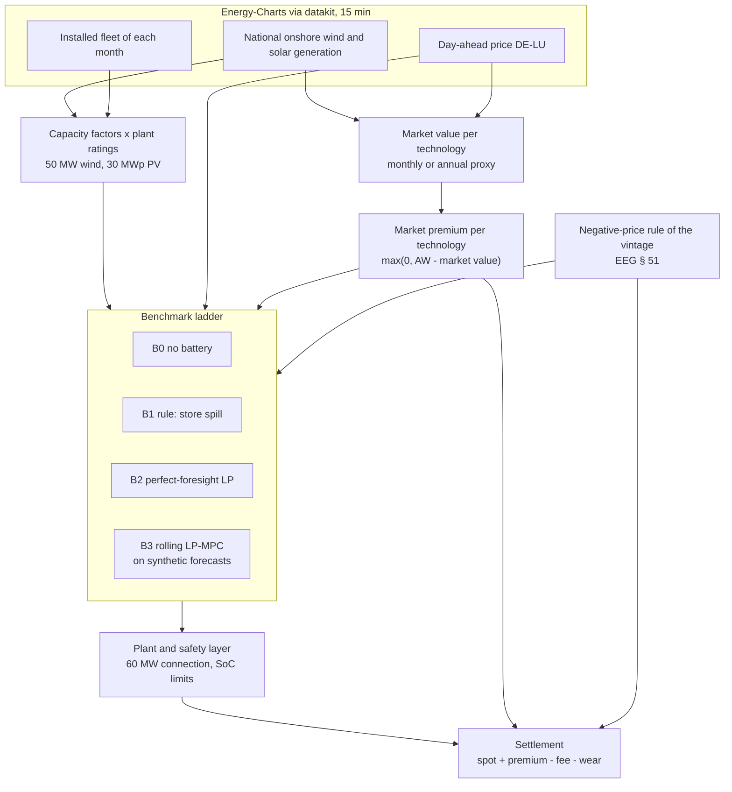

# Project 02 · Utility-Scale Hybrid Wind + PV + Battery Plant Dispatch

**Dispatch of a co-located wind, PV and battery plant behind one grid connection in Germany,
under EEG direct marketing and the negative-price rule of each plant vintage. Evaluated on a
benchmark ladder from B0 (no battery) to B3 (rolling MPC), whose optimisers are linear
programs solved with PuLP and CBC, on Energy-Charts data for the calendar years 2024 and
2025.**

| | |
|---|---|
| **Status** | Ladder B0 to B3 implemented and evaluated; the project stops at B3, on purpose (below). 175 tests, all offline |
| **Method** | B0 no battery · B1 rule-based storage · B2 perfect-foresight LP · B3 rolling LP-MPC on synthetic forecasts |
| **Asset** | 50 MW onshore wind + 30 MWp PV + a 20 MW / 40 MWh battery behind a 60 MW connection; not a real site |
| **Markets** | Day-ahead price and the EEG market premium per technology. Not modelled: intraday trading, a day-ahead schedule settled at reBAP, redispatch. aFRR is not built yet: its settings in `MarketConfig` are inert |
| **Data** | National wind and solar generation, installed capacity and day-ahead prices from Energy-Charts (CC BY 4.0) |
| **Resolution** | 15 min |

> **Project 02 stops at B3, on purpose.** A learned policy is worth training where a rolling
> MPC cannot keep up with the problem, and this model does not pose such a problem yet. Each
> reason can be checked in the code and the tables:
>
> 1. **No rung commits a day-ahead schedule.** `market.settle` prices a deviation from a
>    committed schedule at reBAP, and `baselines.run_ladder` accepts a `schedule`, but no rung
>    produces one and no command passes one. So `imbalance_cost_eur` is 0 in every row of
>    every table.
> 2. **No redispatch.** `market.redispatch_series` exists, but no command calls it or passes
>    an export cap, and `tables.INERT_SETTINGS` names its settings as unused.
> 3. **The connection does not bind on national profiles.** At the plant's 60 MW,
>    `steps_over_connection` is 0 in every Energy-Charts window of
>    [`window_stats.csv`](reports/window_stats.csv). The curtail-or-store decision appears
>    only where the sizing sweep narrows the connection.
> 4. **The premium is deterministic.** It is one realised rate per technology and calendar
>    month or year (`market.premium_table`), and B3 plans on the previous month's realised
>    rate (`market.planning_rates`). No random premium state is left for a policy to learn.
>
> Reinforcement learning is shown in [Project 01](../01-prosumer-pv-bess-mpc-rl/), on a
> household PV battery: a soft actor-critic agent reaches 32.4 % of the gain from B1 to B2
> (median of three seeds), against 89.4 % for its rolling MPC
> ([`rl_summary.csv`](../01-prosumer-pv-bess-mpc-rl/reports/rl_eval_H28/rl_summary.csv)).
> Here, RQ3/H3 and the RL work packages (WP8, WP9) are future work. They become worth doing
> once every rung commits a day-ahead schedule that is settled at reBAP.

## 0. Results

Every result in this section comes from a committed CSV in [`reports/`](reports/), and
`tests/test_readme_results.py` checks the tables and key results below against them.
[`reports/SOURCE.md`](reports/SOURCE.md) says how the set was run, on which data and under
which licence.

### Key results

B2 knows prices and generation in advance, so its figures are upper bounds.

- **The battery's own value** (B2 minus B2 without a battery) rises with every step of
  connection size in both years: from 1,094,990 EUR at 20 MW to 1,240,768 EUR at 60 MW in
  2024, and from 1,298,361 to 1,462,929 EUR in 2025. Curtailing at low prices, which needs no
  battery, adds 124,552 to 139,331 EUR in 2024 and 138,351 to 150,355 EUR in 2025.
- **The 60 MW connection never binds** on national profiles, in either year. There, B1 earns
  exactly what B0 earns, and the connection limit changes the battery's value by 0. A 30 MW
  connection changes it by -32,376 EUR in 2024 and -37,755 EUR in 2025 (-2.7 % and -2.6 %).
  On these data the battery's value is arbitrage.
- **B3**, the deployable rolling MPC, recovers 94.1 % (January 2025) and 95.4 % (July 2025)
  of the gain from B1 to B2, which here is the gain from B0 to B2. It plans on the previous
  month's realised premium, 0.00 and 27.34 EUR/MWh, and is settled on 1.48 and 8.74 EUR/MWh.
- **Every tightening of the negative-price rule** lowers B0's revenue and raises the energy
  B2 chooses to curtail, for both vintages in both years. Under the rule of the newest
  plants, B2 curtails 6,715 MWh in 2024 and 8,155 MWh in 2025 at the default plant.
- **No row of any table** breaks a plant limit, settles any imbalance or buys grid energy:
  each is 0 in every row.

### Reproduce

```bash
pip install -e ".[dev]" && python -m pytest tests/ -q   # 175 tests, offline
python -m hybrid.cli report                     # every table below, in series: about an hour
python -m hybrid.cli report --only sizing_2024  # one table, by the name of its CSV
```

`report` runs each command below and adds `--out reports/<table>.csv` to it. Beside the
tables it writes [`window_stats.csv`](reports/window_stats.csv) (per window: prices,
generation and whether the connection binds) and [`run_meta.csv`](reports/run_meta.csv) (per
table: commit, versions, input hashes, sources and wall time). The data come from
Energy-Charts through the repository's `datakit`, which caches every response; no key is
needed.

How each table is made (the commands `report` ran, as `run_meta.csv` records them):

| Table | Window, Berlin time | Command |
|---|---|---|
| [`sizing_2024.csv`](reports/sizing_2024.csv) | calendar year 2024 | `python -m hybrid.cli sizing --year 2024 --full-year` |
| [`sizing_2025.csv`](reports/sizing_2025.csv) | calendar year 2025 | `python -m hybrid.cli sizing --year 2025 --full-year` |
| [`decompose_2024.csv`](reports/decompose_2024.csv) | calendar year 2024 | `python -m hybrid.cli decompose --year 2024 --full-year` |
| [`decompose_2024_conn-30.csv`](reports/decompose_2024_conn-30.csv) | calendar year 2024 | `python -m hybrid.cli decompose --year 2024 --full-year --conn 30` |
| [`decompose_2025.csv`](reports/decompose_2025.csv) | calendar year 2025 | `python -m hybrid.cli decompose --year 2025 --full-year` |
| [`decompose_2025_conn-30.csv`](reports/decompose_2025_conn-30.csv) | calendar year 2025 | `python -m hybrid.cli decompose --year 2025 --full-year --conn 30` |
| [`negprice_2024.csv`](reports/negprice_2024.csv), [`negprice_2024_premium.csv`](reports/negprice_2024_premium.csv) | calendar year 2024 | `python -m hybrid.cli negprice --year 2024 --full-year` |
| [`negprice_2025.csv`](reports/negprice_2025.csv), [`negprice_2025_premium.csv`](reports/negprice_2025_premium.csv) | calendar year 2025 | `python -m hybrid.cli negprice --year 2025 --full-year` |
| [`ladder_2025-01-01_30d.csv`](reports/ladder_2025-01-01_30d.csv) | 1 to 30 January 2025 | `python -m hybrid.cli ladder --year 2025 --start 01-01 --days 30` |
| [`ladder_2025-07-01_30d.csv`](reports/ladder_2025-07-01_30d.csv) | 1 to 30 July 2025 | `python -m hybrid.cli ladder --year 2025 --start 07-01 --days 30` |
| [`b3_ablation_synthetic_demo.csv`](reports/b3_ablation_synthetic_demo.csv) | 3 synthetic days | `python -m hybrid.cli b3-ablation --synthetic-demo` |

A calendar year runs from midnight on 1 January to midnight on the next 1 January, Berlin
time. The ladder tables also read 2024: B3's price-forecast error is sized on the 2024
day-ahead price, and in the January window B3 plans on December 2024's premium.

### Windows

The plant has 80 MW installed (50 MW wind + 30 MWp PV) behind 60 MW; the synthetic days run
it behind 40 MW. The largest combined capacity factor is the peak generation over the 80 MW.
Quarter-hours are counted as such: from 1 October 2025 the day-ahead price is set per
quarter-hour, so the 2025 count is not four times a count of hours.

Windows of the tables ([`window_stats.csv`](reports/window_stats.csv)):

| Window, Berlin time | Quarter-hours | Mean day-ahead price EUR/MWh | Quarter-hours with a negative price | Peak generation MW | Largest combined capacity factor | Connection MW | Quarter-hours above the connection |
|---|---:|---:|---:|---:|---:|---:|---:|
| calendar year 2024 | 35,136 | 78.51 | 1,828 | 42.5 | 0.531 | 60 | 0 |
| calendar year 2025 | 35,040 | 89.32 | 2,299 | 38.3 | 0.479 | 60 | 0 |
| 1 to 30 January 2025 | 2,880 | 113.24 | 56 | 35.3 | 0.442 | 60 | 0 |
| 1 to 30 July 2025 | 2,880 | 87.87 | 48 | 25.4 | 0.318 | 60 | 0 |
| 3 synthetic days | 288 | 70.14 | 2 | 79.9 | 0.999 | 40 | 183 |

### 0.1 Connection size: the battery and curtailing at low prices (RQ2)

`sizing` sweeps the connection from 20 to 60 MW with the battery fixed. B0 has no battery and
curtails only what the connection forces. "B2 no battery" is B2 with the battery taken out:
perfect foresight that can only curtail. So B2 minus B0 splits into two parts that add up:
**the battery's own value** (B2 minus B2 no battery) and **curtailing at low prices** (B2 no
battery minus B0), which needs no battery. Every row runs the rule of the newest plants
(`new_2025`) and the default plant's annual premium (0.3).

Connection sweep, calendar year 2024 ([`sizing_2024.csv`](reports/sizing_2024.csv)):

| Connection MW | Overbuild | B0 EUR | B1 EUR | B2 EUR | The battery's own value EUR | Curtailing at low prices EUR | B0 forced curtailment MWh |
|---|---:|---:|---:|---:|---:|---:|---:|
| 20 | 4.00 | 7,343,890 | 7,520,155 | 8,563,432 | 1,094,990 | 124,552 | 9,525 |
| 25 | 3.20 | 7,602,732 | 7,673,426 | 8,909,720 | 1,171,509 | 135,479 | 3,701 |
| 30 | 2.67 | 7,713,324 | 7,739,659 | 9,060,224 | 1,208,392 | 138,508 | 1,079 |
| 40 | 2.00 | 7,761,498 | 7,761,820 | 9,137,629 | 1,236,800 | 139,331 | 6 |
| 60 | 1.33 | 7,761,582 | 7,761,582 | 9,141,681 | 1,240,768 | 139,331 | 0 |

Connection sweep, calendar year 2025 ([`sizing_2025.csv`](reports/sizing_2025.csv)):

| Connection MW | Overbuild | B0 EUR | B1 EUR | B2 EUR | The battery's own value EUR | Curtailing at low prices EUR | B0 forced curtailment MWh |
|---|---:|---:|---:|---:|---:|---:|---:|
| 20 | 4.00 | 7,334,501 | 7,485,124 | 8,771,213 | 1,298,361 | 138,351 | 5,458 |
| 25 | 3.20 | 7,475,060 | 7,523,341 | 9,004,543 | 1,383,379 | 146,104 | 1,675 |
| 30 | 2.67 | 7,515,130 | 7,524,704 | 9,090,011 | 1,425,174 | 149,708 | 292 |
| 40 | 2.00 | 7,521,764 | 7,521,764 | 9,129,478 | 1,457,359 | 150,355 | 0 |
| 60 | 1.33 | 7,521,764 | 7,521,764 | 9,135,049 | 1,462,929 | 150,355 | 0 |

The battery's own value rises with every step of connection size in both years: a tight
connection holds back the battery's discharge along with the plant's export, and that costs
more than the spill it lets the battery store is worth (0.2). Where no generation exceeds the
connection, B1 earns exactly what B0 earns, because B1 only stores spill. The tables show
revenue, not an optimum: the project models no cost for the connection or the battery.

### 0.2 Where the battery's value comes from (RQ1)

`decompose` runs the plant at its connection as built and at 200 MW, which nothing reaches.
With no spill to store, the battery's value at 200 MW is arbitrage: the plant's own energy
sold at better prices. The difference is the connection limit's effect: the spill the battery
stores, net of the discharge the limit holds back.

The battery's value by connection ([`decompose_2024.csv`](reports/decompose_2024.csv), [`decompose_2024_conn-30.csv`](reports/decompose_2024_conn-30.csv), [`decompose_2025.csv`](reports/decompose_2025.csv), [`decompose_2025_conn-30.csv`](reports/decompose_2025_conn-30.csv)):

| Year | Connection as built MW | The battery's value as built EUR | The battery's value at 200 MW EUR | Connection limit's effect EUR | Share of the value as built |
|---|---:|---:|---:|---:|---:|
| 2024 | 60 | 1,240,768 | 1,240,768 | 0 | 0.0 % |
| 2024 | 30 | 1,208,392 | 1,240,768 | -32,376 | -2.7 % |
| 2025 | 60 | 1,462,929 | 1,462,929 | 0 | 0.0 % |
| 2025 | 30 | 1,425,174 | 1,462,929 | -37,755 | -2.6 % |

At 60 MW the effect is 0 by construction, because the connection never binds. 30 MW is the
widest connection of the sweep that the plant's generation exceeds in both years, and there
the effect is negative. On national profiles the battery earns from arbitrage, not from
storing spill. Forecast-error management, the third source in H1, needs a schedule settled at
reBAP, which no rung commits.

### 0.3 The negative-price rule by vintage (RQ4)

**The premium.** The law pays each technology max(0, applicable value - market value) on its
own export, wherever the premium is payable. Plants commissioned or awarded before 2023 are
paid against the technology's monthly market value; plants commissioned and, if tendered,
awarded from 2023 on, against its annual value (EEG 2023 Anlage 1 Nr. 2). The model pays the
plant one blended rate per period, the two premiums weighted by its own available generation
in the window (`market.premium_table`). The market values are computed proxies: the
day-ahead price weighted by national generation (Anlage 1 Nr. 3.3, 4.3). The premium is
legally settled on the values the TSOs publish, which this project does not load.
`market.market_values` expects the proxy to run high, so the premiums run low; no committed
data measures by how much.

There are two vintages. The **recent** one is the default plant of every other table: its
applicable values are 73.5 EUR/MWh for wind and 68.0 for PV, the 2024/2025 tender ceilings
that `MarketConfig` cites, not an award, and it is paid against the annual market value. The
**older** one, at 95.0 and 90.0 EUR/MWh against the monthly value, is a sensitivity.

Premium by vintage, the mean over the year's quarter-hours ([`negprice_2024.csv`](reports/negprice_2024.csv), [`negprice_2025.csv`](reports/negprice_2025.csv); by month in [`negprice_2024_premium.csv`](reports/negprice_2024_premium.csv), [`negprice_2025_premium.csv`](reports/negprice_2025_premium.csv)):

| Year | Vintage | Market value | Wind market value EUR/MWh | PV market value EUR/MWh | Wind premium EUR/MWh | PV premium EUR/MWh | Plant rate EUR/MWh | No premium for |
|---|---|---|---:|---:|---:|---:|---:|---|
| 2024 | AW 73.5 (recent onshore) | annual | 64.44 | 46.29 | 9.06 | 21.71 | 11.77 | none |
| 2024 | AW 95.0 (older vintage) | monthly | by month | by month | 31.09 | 34.09 | 33.55 | PV in 2024-11, PV in 2024-12 |
| 2025 | AW 73.5 (recent onshore) | annual | 77.37 | 45.87 | 0.00 | 22.13 | 5.23 | wind in 2025 |
| 2025 | AW 95.0 (older vintage) | monthly | by month | by month | 18.93 | 32.03 | 24.55 | PV in 2025-01, wind in 2025-02, PV in 2025-02, PV in 2025-11, PV in 2025-12 |

**The rules, as implemented** (`market.vintage_rules`; `market.py` cites the statute texts).
A plant's vintage is its commissioning date or, for a tendered plant, the bid date of its
tender where EEG § 100 says so. `none` always pays the premium. The rules from `six_hour` to
`three_hour` remove it for the whole run of negative prices once the run lasts that many
hours. Runs are counted in calendar hours, and an hour counts as negative when the mean of its
quarter-hour prices is negative (§ 100 (45) EEG 2023). `new_2025` removes the premium in every
negative period. The threshold of the vintage from 2023 to 24 February 2025 falls by calendar
year: four hours in 2023, three in 2024 and 2025, two in 2026 and one from 2027. Not
modelled: the § 51a extension of the support period and the small-plant exemptions of
§ 51 (2).

Negative-price rule, calendar year 2024 ([`negprice_2024.csv`](reports/negprice_2024.csv)):

| Rule | Plants that carry it in 2024 | Recent: B0 EUR | Recent: B2 EUR | Recent: B2 chosen curtailment MWh | Older: B0 EUR | Older: B2 EUR | Older: B2 chosen curtailment MWh |
|---|---|---:|---:|---:|---:|---:|---:|
| `none` | before 2016 | 7,878,022 | 9,176,077 | 1,982 | 10,318,068 | 11,543,553 | 377 |
| `six_hour` | 2016-2020 | 7,808,365 | 9,157,002 | 4,762 | 10,090,622 | 11,429,260 | 4,632 |
| `four_hour` | 2021-2022 | 7,777,455 | 9,144,622 | 6,387 | 9,992,663 | 11,372,768 | 6,387 |
| `three_hour` | 2023 to 24 Feb 2025 | 7,768,887 | 9,142,287 | 6,660 | 9,964,021 | 11,362,787 | 6,660 |
| `new_2025` | from 25 Feb 2025 | 7,761,582 | 9,141,681 | 6,715 | 9,940,599 | 11,360,790 | 6,715 |

Negative-price rule, calendar year 2025 ([`negprice_2025.csv`](reports/negprice_2025.csv)):

| Rule | Plants that carry it in 2025 | Recent: B0 EUR | Recent: B2 EUR | Recent: B2 chosen curtailment MWh | Older: B0 EUR | Older: B2 EUR | Older: B2 chosen curtailment MWh |
|---|---|---:|---:|---:|---:|---:|---:|
| `none` | before 2016 | 7,584,010 | 9,143,413 | 3,208 | 9,655,042 | 11,140,539 | 223 |
| `six_hour` | 2016-2020 | 7,539,912 | 9,137,448 | 6,829 | 9,336,133 | 10,956,994 | 6,506 |
| `four_hour` | 2021-2022 | 7,527,595 | 9,135,679 | 7,856 | 9,242,621 | 10,911,640 | 7,792 |
| `three_hour` | 2023 to 24 Feb 2025 | 7,523,655 | 9,135,125 | 8,113 | 9,216,531 | 10,903,216 | 8,053 |
| `new_2025` | from 25 Feb 2025 | 7,521,764 | 9,135,049 | 8,155 | 9,205,646 | 10,902,358 | 8,074 |

B1 equals B0 in every row, because the 60 MW connection never binds, so the tables leave it
out. Each row runs one rule on both vintages, as a sensitivity. Under the statute the older
vintage (monthly value, so dated before 2023) carries `none`, `six_hour` or `four_hour`, and
the recent vintage carries `three_hour` or `new_2025`. No plant carried `new_2025` before
25 February 2025, so on the prices before that day its row is a counterfactual.

B0 cannot react, so its loss from `none` to a rule is the premium the rule removes. B2
curtails more with every tightening and loses less than B0 to every rule. Part of that is
curtailing, which needs no battery; `negprice` runs no "B2 no battery", so the tables do not
split the two. Two approximations of the settlement favour storage (section 11): the rule
applies at the step of export, so energy charged during a suspension earns the premium when
it is sold later, and one blended premium rate per period misprices the steps the rule acts
on. Read B0's loss minus B2's loss as an upper bound on what storage and curtailing recover.

### 0.4 B3 on real data: two 30-day windows of 2025

B3 re-solves the LP every quarter-hour over the next 24 hours on synthetic forecasts
(section 11) and applies the first step; it knows the current quarter-hour exactly. It plans
each month on the previous month's realised premium rate: December 2024's in the January
window and June 2025's in the July window. Every rung is settled on the realised annual
market value of 2025, at the plant's rate for the window's own wind/PV mix.

B3 on 30 days of real data ([`ladder_2025-01-01_30d.csv`](reports/ladder_2025-01-01_30d.csv), [`ladder_2025-07-01_30d.csv`](reports/ladder_2025-07-01_30d.csv)):

| Window, Berlin time | B0 EUR | B1 EUR | B2 EUR | B3 EUR | B3's share of the B1-to-B2 gain | Premium settled on EUR/MWh | Premium B3 planned on EUR/MWh |
|---|---:|---:|---:|---:|---:|---:|---:|
| 1 to 30 January 2025 | 909,598 | 909,598 | 1,001,522 | 996,142 | 94.1 % | 1.48 | 0.00 |
| 1 to 30 July 2025 | 554,183 | 554,183 | 656,969 | 652,211 | 95.4 % | 8.74 | 27.34 |

The connection never binds in either window, so B1, which only stores spill, earns exactly
what B0 earns, and the gain from B1 to B2 is really the gain from B0 to B2. B3 recovers most
of it, although in July it plans on a premium far above the one it is settled on. B3's solve
times are in the CSVs (`b3_solve_time_*`); four runs shared a 4-core laptop, so they give an
order of magnitude only.

### 0.5 B3 against a terminal value, on synthetic inputs

Every input of this table is synthetic, from `hybrid.synthetic`: the portfolio showcase's
three days of wind, PV and price shapes, the default plant behind a 40 MW connection, B3 on a
12-hour horizon, and one fixed premium of 8 EUR/MWh for every rung. It crosses B3's forecast
error with a linear terminal value on the energy stored at the end of each plan.

B3 ablation on synthetic inputs ([`b3_ablation_synthetic_demo.csv`](reports/b3_ablation_synthetic_demo.csv)):

| Forecast error | Terminal value | B0 EUR | B1 EUR | B2 EUR | B3 EUR | B3's share of the B1-to-B2 gain | Energy B3 holds at the end MWh |
|---|---|---:|---:|---:|---:|---:|---:|
| 0 % | off | 190,105 | 197,153 | 198,625 | 198,625 | 100.0 % | 2.0 |
| 0 % | on | 190,105 | 197,153 | 198,625 | 195,058 | -142.4 % | 34.3 |
| 15 % | off | 190,105 | 197,153 | 198,625 | 198,435 | 87.1 % | 2.0 |
| 15 % | on | 190,105 | 197,153 | 198,625 | 194,517 | -179.1 % | 38.0 |

Under perfect forecasts and without a terminal value, B3 matches B2. With the linear terminal
value B3 falls below B1, and it ends the window holding energy it never sells. That is why
the terminal value is off by default (`baselines.default_terminal_price`).

### 0.6 Defects the ladder invariant caught

No rung may beat B2, perfect foresight, on revenue before imbalance, beyond the solver's
rounding (`ladder_tolerance_eur` in every table). `baselines.run_ladder` raises otherwise.

**The market value was once derived from the plant's own export.** A controller that
correctly curtails during negative prices concentrates its output in high-price hours. That
raised its own apparent market value and cut its own premium, so perfect foresight scored
below a do-nothing baseline. The market value is a national figure that one plant cannot
move; it is now exogenous. The invariant then covered B3 only; it now covers every rung,
which would have caught this at once.

**Two B3 defects** surfaced when the portfolio showcase first printed live numbers, on
19 September 2026:

1. **Plan execution.** B3 applied the curtailment fraction it planned on forecast generation
   to the true generation, and so discarded energy the connection could have taken. It now
   executes planned curtailment only where the effective price is negative; elsewhere the
   connection limit alone caps the export.
2. **Terminal value.** A linear value on end-of-horizon storage made B3 hoard energy and lose
   to B1 (0.5). A linear terminal value pushes storage to a bound, because its slope is right
   at one state of charge only. If one is ever needed, it should be concave and depend on the
   state of charge. Project 01 shows the same effect.

`test_rolling_mpc_beats_the_rule_based_baseline` asserts that B3 beats B1 on a synthetic
window. Curtailment is also classified by cause: what the connection would force anyway is
*forced*, and only the rest is *chosen*. Before, every curtailment a plan asked for counted
as chosen, including what the connection forced.

> **Principal caveat on this dataset.** Wind and PV are national capacity factors, far
> smoother than any single site. Their largest combined factor stays well below 1 (Windows),
> so a connection at 75 % of the installed 80 MW never binds and the curtailment problem this
> project is about hardly arises. That is why the sweep runs down to 20 MW, a quarter of the
> installed capacity. On site-level data the curve would sit further right and curtailment
> would be larger. Site-level generation data is the top acquisition priority.

---

## 1. Background and motivation

Co-location is the dominant new build pattern in Germany: wind and PV behind a shared grid
connection point, increasingly with a battery. The connection is deliberately **undersized**
against the sum of the nameplate ratings, because wind and PV peaks rarely coincide. That
undersizing is the source of both the value and the difficulty.

The control problem has four interacting features. This project models the first two; the
other two are motivation for future work.

**A shared, binding connection constraint.** When wind and PV peak together, something must
give: curtail, or charge the battery. The choice depends on price, state of charge, forecast
and remuneration regime. *Modelled; on national profiles the connection binds only below
60 MW (section 0).*

**A discontinuous revenue function.** Under EEG direct marketing the plant earns the market
price plus the market premium, except during negative prices, when `§ 51 EEG` removes the
premium. How long prices must stay negative before it goes depends on the plant's vintage;
the 2025 Solarspitzengesetz removes it in every negative period for new plants. The best
action in a negative-price quarter-hour can differ completely from the one a quarter-hour
earlier. *Modelled, for every vintage (0.3).*

**Forecast error.** A real plant commits a quarter-hourly schedule day-ahead and pays or earns
reBAP on the deviation. With 80 MW of weather-driven capacity, forecast error, not arbitrage
skill, would then set the variance of the result, and a distributional policy might beat a
point-forecast MPC. *Not modelled: no rung commits a schedule, so imbalance is 0 in every
table.*

**Overrides.** Under Redispatch 2.0 the network operator can order the plant down, and
ordered curtailment settles differently from chosen curtailment. *Not modelled: no command
applies an order.*

**Relationship to the author's other work.** This project is the public-data, utility-scale
counterpart to the applied industrial thesis work. It uses no company data, so every result is
publishable and reproducible from open sources.

---

## 2. Regulatory and market context

| Instrument | How it enters the model |
|-----------|-------------------------|
| **EEG direct marketing** (`§§ 20 ff. EEG`) | Revenue = day-ahead price + market premium - marketing fee (3 EUR/MWh). Per technology, premium = max(0, applicable value - market value): the monthly market value for plants commissioned or awarded before 2023, the annual value from 2023 on (Anlage 1 Nr. 2 EEG 2023). The market value is a national figure, so the objective stays separable in time. It is computed as a proxy (0.3) |
| **Negative-price rule** (`§ 51 EEG`, tightened by the 2025 Solarspitzengesetz) | Implemented per vintage: none before 2016; six hours (2016-2020) or four hours (2021-2022) of negative prices remove the premium for the whole run; the threshold of the vintage from 2023 to 24 February 2025 falls from four hours in 2023 to one from 2027; from 25 February 2025, every negative period. **Not modelled:** the § 51a extension of the support period and the § 51 (2) small-plant exemptions |
| **Remote controllability** (`§ 9 EEG`) | The technical basis of an override channel. **Not modelled** |
| **Redispatch 2.0** (`§§ 13a, 14c EnWG`) | **Not modelled:** no command applies an order; its settings in `MarketConfig` are inert |
| **Grid connection capacity** | The plant's export limit (`PlantConfig.conn_mw`, 60 MW), enforced in every quarter-hour; `sizing` sweeps it from 20 to 60 MW |
| **Imbalance settlement / reBAP** | `market.settle` prices a deviation from a committed schedule at reBAP, but no rung commits a schedule, so imbalance is 0 in every table. The reBAP series is synthetic |
| **Balancing markets** | aFRR participation by the battery is **not built yet**: its settings in `MarketConfig` are inert, and no command reads them |
| **Storage regulatory treatment** | `PlantConfig.grid_charging_allowed` is off in every table. With it on, the LP still cannot buy from the grid, because its export stays at or above 0, and `run_ladder` refuses a run in which a rung charged grid energy while a premium is paid. **Not modelled** |

---

## 3. Scope and objectives

### In scope, as built

- A 15-minute co-located plant: national capacity factors scaled to 50 MW of wind and 30 MWp
  of PV, a battery with efficiency, state-of-charge limits and linear throughput wear, and a
  shared connection point.
- The benchmark ladder B0 to B3, and B2 without a battery.
- Settlement on the day-ahead price and the EEG market premium per technology, with the
  negative-price rule of each vintage.
- Curtailment split by cause: chosen, an economic decision, and forced by the connection.
- A connection-capacity sweep at a fixed battery.

### Not built

- A learned policy (future work; see the note at the top).
- Wind power curves, a wake model, and a PV and inverter model such as `pvlib`: generation is
  a national capacity factor times the rating.
- A day-ahead schedule, intraday trading and imbalance exposure.
- Redispatch orders, and aFRR participation, whose settings are inert.
- A battery size sweep.

### Out of scope

- Wake steering and turbine-level control (item B3 of the
  [idea backlog](../../docs/06-idea-backlog.md), not the ladder rung).
- Grid connection studies and detailed power quality.
- PPA structuring and hedging strategy (a natural extension, noted).
- Long-term investment appraisal.

### Objectives

1. Quantify the value of co-location plus storage against separate operation of the same
   assets, under German rules. *Done: B0 against B2 (0.1).*
2. Determine the optimal degree of connection undersizing, and how it shifts with battery size
   and with the negative-price regime. *Revenue by connection size for one battery under the
   rule of the newest plants (0.1); no cost is modelled, so there is no optimum.*
3. Establish how much of the battery's value comes from forecast-error management, arbitrage
   and curtailment avoidance. *Arbitrage against the connection limit's effect (0.2);
   forecast-error management needs a schedule.*
4. Test whether a distributional learned policy beats a tuned MPC where the imbalance tail
   dominates. *Future work.*
5. Quantify the economic effect of the negative-price rule's tightening, by plant vintage.
   *Done (0.3).*

---

## 4. Research questions and hypotheses

| # | Research question | Hypothesis | Status |
|---|-------------------|-----------|--------|
| RQ1 | Where does the battery's value in a hybrid plant actually come from? | H1: Forecast-error management and curtailment avoidance dominate pure arbitrage at realistic German connection ratios; the ordering reverses only at high connection headroom | Not supported on national profiles: the battery's value is arbitrage, and a tight connection lowers it (0.2). Forecast-error management cannot be measured without a schedule |
| RQ2 | What is the optimal connection-capacity ratio? | H2: Well below the sum of nameplates, with the optimum shifting **upward** as the negative-price rule tightens (curtailment becomes cheap, so firm export capacity is worth less) | Not tested: revenue rises with the connection at every step (0.1), but no cost is modelled, and the sweep runs under one rule only |
| RQ3 | Does a learned policy beat rolling MPC? | H3: Yes, modestly, and specifically in high-forecast-error periods, by managing imbalance-tail risk that a point-forecast MPC ignores | Future work, once every rung commits a day-ahead schedule settled at reBAP (note at the top) |
| RQ4 | What does the tightened negative-price rule cost a new plant relative to an old one? | H4: Material, and partly recoverable by storage; quantifying "partly" is the deliverable | Measured by vintage (0.3). B2 loses less than B0, but the settlement overstates what storage recovers, and curtailing is not split from the battery |
| RQ5 | Is aFRR participation worth it for the battery? | H5: Only when the connection is not the binding constraint; where curtailment risk is high, reserved headroom is too expensive | Not testable: aFRR is not built yet, and its settings are inert |

---

## 5. System architecture, as built



Not built: NWP-driven generation, a forecast layer, intraday prices, a day-ahead schedule and
reBAP, redispatch orders, aFRR (its settings are inert) and a learned policy.

---

## 6. Problem formulation

### 6.1 Plant model

Wind and PV: the national capacity factor of each quarter-hour times the rating (50 MW,
30 MWp), with no power curve, wake model, irradiance model or inverter clipping. Battery:
20 MW / 40 MWh, used between 5 % and 95 % of its energy, 95 % efficient each way, starting at
its minimum, with linear wear of 3 EUR per MWh charged or discharged; no calendar ageing or
rainflow counting. Point of interconnection: a hard export limit of 60 MW. Grid charging is
off.

### 6.2 Linear program (B2 / B3)

An LP with no binary variables: with wear priced, charging and discharging at once never pays.

```
maximise   Σ_t [ p(t)·e(t) − c_w·(ch(t) + dis(t)) ]·Δt  +  V·soc(T)

p(t) = π_DA(t) + MP(t)·1[premium payable in t] − fee          effective price
subject to, in every quarter-hour t:
  g(t) ≤ ĝ_wind(t) + ĝ_pv(t)                 generation used; the rest is curtailed
  e(t) = g(t) + dis(t) − ch(t),   0 ≤ e(t) ≤ conn
  ch(t) ≤ g(t)                                no grid charging
  soc(t) = soc(t−1) + (η_c·ch(t) − dis(t)/η_d)·Δt,   soc_min ≤ soc(t) ≤ soc_max
  0 ≤ ch(t), dis(t) ≤ P_bat
```

V is 0 unless the terminal value is switched on (0.5). B2 solves this once over the whole
window on the realised premium. B3 solves it every quarter-hour over the next 96
quarter-hours (48 on the synthetic days), with forecasts in place of the future and the
previous month's realised premium, and applies the first step. The settlement (`market.settle`) then pays spot on the
export and the premium on the export where it is payable, and charges the marketing fee and
the wear; imbalance and grid imports are 0 in every table.

**Not implemented: a month-to-date premium accumulator.** It is not needed: the market value
is a national figure one plant cannot move, so nothing couples the month inside the
optimisation. A controller must still estimate the value before its period ends; B3 takes the
previous month's realised rate.

### 6.3 RL formulation: not implemented

The RL work packages are future work (note at the top). They need a day-ahead schedule per
rung, settled at reBAP on real reBAP data. Only then does the imbalance tail, which a
distributional critic or a CVaR objective would target, exist in the model.

---

## 7. Data

| Data | Purpose | Source | Resolution |
|------|---------|--------|-----------|
| National onshore wind feed-in | Wind capacity factor, numerator | Energy-Charts `public_power` | 15 min |
| National solar generation, self-consumption included | PV capacity factor, numerator | Energy-Charts `total_power` | 15 min |
| National solar feed-in to the public grid | PV weight of the market-value proxy | Energy-Charts `public_power` | 15 min |
| Installed onshore wind and Solar DC fleet | Capacity factors, denominators | Energy-Charts `installed_power` | One value per month |
| DE-LU day-ahead price | Revenue and market values | Energy-Charts `price` (Bundesnetzagentur, SMARD.de) | Hourly; 15 min from 1 October 2025 |

All are under CC BY 4.0 and read through the repository's `datakit`.
[`reports/SOURCE.md`](reports/SOURCE.md) gives the requests, the credits and a check for
upstream revisions.

**Not used yet:** NWP and reanalysis (DWD ICON-D2/EU, ERA5), turbine power curves, MaStR plant
data, intraday prices, real reBAP and the TSOs' published market values (both on
netztransparenz.de), redispatch measures, balancing capacity prices (aFRR is not built yet)
and site-level metered generation.

**Validation against aggregate generation: not implemented.** The capacity factors are the
national aggregate, so there is nothing independent to validate them against until a
weather-to-power chain exists.

---

## 8. Baselines and evaluation

| Rung | As built |
|------|--------------|
| **B0** | The same generation without a battery. Curtails only what the connection forces, and sells through negative prices |
| **B1** | Stores what the connection would spill and discharges into headroom; reads no prices. Equals B0 wherever the connection never binds |
| **B2** | Perfect-foresight LP over the whole window, on the realised premium: the ceiling of the ladder |
| **B2 no battery** | B2 with the battery taken out: perfect foresight that can only curtail. Splits B2's gain over B0 into the battery and curtailing at low prices |
| **B3** | Rolling LP-MPC: a 24-hour horizon re-solved every quarter-hour on synthetic forecasts, planning on the previous month's realised premium, with no terminal value |
| **RL** | Not implemented (future work) |

**KPIs, as built:** net revenue over the window, split into spot revenue, premium, marketing
fee, wear, imbalance and grid imports (EUR); export and curtailment, chosen and forced (MWh);
constraint violations, 0 in every row; and B3's share of the gain from B1 to B2. **Not
implemented:** daily distributions, quantiles and CVaR, intraday and aFRR terms, and
equivalent full cycles.

**Ablations run:** the connection sweep (0.1), the connection limit's effect (0.2), the
negative-price rule by vintage (0.3), and B3's forecast error against a terminal value on
synthetic inputs (0.5). **Not run:** battery size, forecast quality on real data, aFRR (not
built yet), grid charging (not modelled), the wear cost, and the safety layer on or off.

---

## 9. Deliverables

1. A 15-minute German hybrid-plant model with the EEG market premium per technology, on
   monthly or annual market values, and the negative-price rule of every vintage.
   *Delivered.* The design's monthly market-value coupling is not needed (6.2).
2. A benchmark ladder B0 to B3 that is reusable for any co-located plant study. *Delivered.*
3. A distributional RL controller with a connection-capacity safety layer. *Future work.*
4. The battery value decomposition. *Delivered for arbitrage against the connection limit's
   effect, and for the battery against curtailing at low prices; forecast-error management
   needs a schedule.*
5. A connection-sizing sensitivity under the current and previous negative-price regimes.
   *Delivered under the rule of the newest plants only.*
6. A written report suitable for conference submission. *Not written.*

---

## 10. Work packages and roadmap

| WP | Content | Depends on | Output | Status |
|----|---------|-----------|--------|--------|
| WP1 | Weather-to-power chain: NWP ingestion, wind and PV conversion, bias correction | none | `src/model`, validation vs. aggregate | Not built; national capacity factors instead |
| WP2 | Market data pipeline: DA, ID, reBAP, market values, redispatch, balancing | none | `data/processed` | Day-ahead prices and computed market values only |
| WP3 | Plant model incl. battery, degradation, point of interconnection | WP1 | `src/model` | Built (`plant.py`), with linear wear only |
| WP4 | Settlement: EEG premium with the vintage switch, imbalance, redispatch compensation | WP2 | `src/market` | Built (`market.py`) without redispatch; imbalance settles a committed schedule, which no rung has |
| WP5 | B0 + B1 + **validation gate** against aggregate generation | WP1, WP3, WP4 | Validation report, **gate** | B0 and B1 built; no validation gate |
| WP6 | Probabilistic wind/PV forecast layer with true issue times (shared with Project 03) | WP1 | `src/forecast` | Not built; B3 uses synthetic forecasts |
| WP7 | LP B2 + B3 rolling MPC | WP3, WP4, WP6 | Strong baseline | Built (`baselines.py`) |
| WP8 | Gymnasium environment + safety layer | WP3, WP6 | `src/envs`, `src/safety` | Future work |
| WP9 | Distributional RL training, seeds | WP8 | Trained policies | Future work |
| WP10 | Evaluation, sizing sweeps, value decomposition, report | WP7, WP9 | `reports/` | Tables in `reports/`; no written report |

---

## 11. Assumptions and limitations

| Dimension | Assumption, as built | Limitation and impact |
|---|---|---|
| **Physical** | 50 MW onshore wind + 30 MWp PV (a DC rating) + a 20 MW / 40 MWh battery behind one 60 MW connection. The battery runs between 5 % and 95 % of its energy at 95 % efficiency each way, starts every window at its minimum, and wears at 3 EUR per MWh of throughput. No grid charging | No power curves, wake losses or inverter clipping: generation is a national factor times the rating. No calendar ageing. Overbuild is (MW wind + MWp PV) / MW connection |
| **Market** | Price-taker on the DE-LU day-ahead price; the EEG market premium per technology under the negative-price rule of the vintage; a marketing fee of 3 EUR/MWh | No intraday trading and no day-ahead schedule, so no imbalance. No § 51a extension. The market values are computed proxies |
| **Data** | Energy-Charts national generation over the national fleet of each month, for 2024 and 2025 | National profiles are smoother than one site, so curtailment is understated |
| **Regulatory** | The connection as a hard export limit; the § 51 thresholds by vintage, cited to the statute in `market.py` | No redispatch. aFRR is not built yet: its settings are inert |

**Limitations, stated plainly:**

1. **The capacity factors are national proxies for one plant.** They are far smoother than a
   single site, so the 60 MW connection never binds and curtailment is understated. Their
   level runs low too, because the national fleet mixes older turbines and rooftop PV with
   new plant. Each month's generation is divided by the fleet at the month's end, so a
   month's factors run low by about half of that month's fleet growth.
2. **PV counts self-consumption.** The PV factor is solar generation including
   self-consumption (Energy-Charts `total_power`) over the DC fleet. Public feed-in leaves
   the self-consumed rooftop output out, so it would understate a fully exporting plant; the
   code uses it only as the PV weight of the market-value proxy
   (`data.market_value_weights`).
3. **The market values are computed proxies.** The premium is legally settled on the values
   the TSOs publish, which the project does not load. `market.market_values` expects the
   proxy to run high, so the premiums computed from it run low; no committed data measures
   the gap.
4. **The settlement approximates the law in two ways that favour storage.** One blended
   premium rate per period misprices every quarter-hour whose wind/PV mix departs from the
   period's, those the negative-price rule acts on included. And the rule applies at the step
   of export, so energy charged while the premium is suspended earns it when sold later,
   whereas § 19 (3) EEG 2023 gives stored energy the claim of the step it was generated in.
5. **B3's forecasts are synthetic perturbations of the truth.** Wind and PV forecasts are the
   true values times (1 + σ·AR(1)), with σ = 15 % and ρ = 0.8, clipped at 0. In the ladder
   tables the price forecast is the effective price plus σ times the standard deviation of
   the 2024 day-ahead price times AR(1). One error series serves every issue time, so the
   error does not grow with lead time. B3 knows the current quarter-hour exactly, and its
   premium mask comes from the true prices.
6. **The results cover the calendar years 2024 and 2025 only**, and B3 two 30-day windows of
   2025.
7. **B2 is perfect foresight**, so its figures, the battery's value included, are upper
   bounds.
8. **No cost is modelled** for the connection, the battery, or wear beyond the linear rate, so
   the sizing tables show revenue, not an optimum.

### Operational risks and mitigations

| Risk | Mitigation |
|------|-----------|
| No site-level generation data for validation | None yet: national factors, stated as a limitation; site data is the top acquisition priority |
| Price-taker assumption | Reasonable at this plant size; stated explicitly |
| Market values are proxies | Called a proxy in the CLI output, in `reports/SOURCE.md` and here; loading the TSOs' published values would remove the gap |
| MPC may win | A legitimate outcome; the sizing and value-decomposition results do not depend on the controller |
| Regulatory vintage rules are complex and evolving | Encoded as explicit rules with the statute cited in `market.py`, and compared across vintages (0.3) |

---

## 12. Repository structure

Follows [`../../templates/project-template/`](../../templates/project-template/); conventions
in [`../../docs/05-tech-stack.md`](../../docs/05-tech-stack.md). A probabilistic forecast
layer would be shared with [Project 03](../03-probabilistic-forecast-to-bid/); B3 does not use
one yet.

```
src/hybrid/
  config.py      plant, market and run settings
  data.py        Energy-Charts capacity factors and prices, through datakit
  market.py      market values, premium, negative-price rule, settlement
  plant.py       plant physics and safety layer
  baselines.py   B0, B1, B2, B2 no battery and B3; the ladder and its invariant
  synthetic.py   the portfolio showcase's synthetic demo inputs
  tables.py      result tables as CSV
  provenance.py  commit, versions and input hashes of a result
  report.py      the publish set, into reports/
  cli.py         the commands
reports/         the committed result tables and SOURCE.md
tests/           offline tests, the README's results included
```

---

## 13. References

- EEG 2023 `§§ 9, 19, 20 ff., 51, 100` and Anlage 1; the 2025 Solarspitzengesetz amendments
  (BGBl. 2025 I Nr. 51); `§§ 13a, 14c EnWG` (Redispatch 2.0). See
  [`../../docs/01-german-market-regulatory-primer.md`](../../docs/01-german-market-regulatory-primer.md);
  `market.py` cites the statute texts it implements.
- Energy-Charts (Fraunhofer ISE), <https://api.energy-charts.info>, CC BY 4.0; the day-ahead
  prices are credited to Bundesnetzagentur | SMARD.de.
- netztransparenz.de: the TSOs' published market values and reBAP, not loaded yet.
- For the planned weather-to-power chain: Marktstammdatenregister, `pvlib`, open turbine
  power-curve databases, DWD ICON model documentation.
- The hybrid/co-located plant dispatch literature, against which the contribution here is the
  German remuneration mechanics by vintage and the battery value decomposition.

---

## 14. Collaboration

Most valuable contributions: site-level metered generation and schedule/imbalance data from a
German co-located plant, even historical, which would let the model commit and settle a
schedule and validate its generation; and a review of the market-premium settlement by a
direct marketer. Enquiries via the issue tracker.
