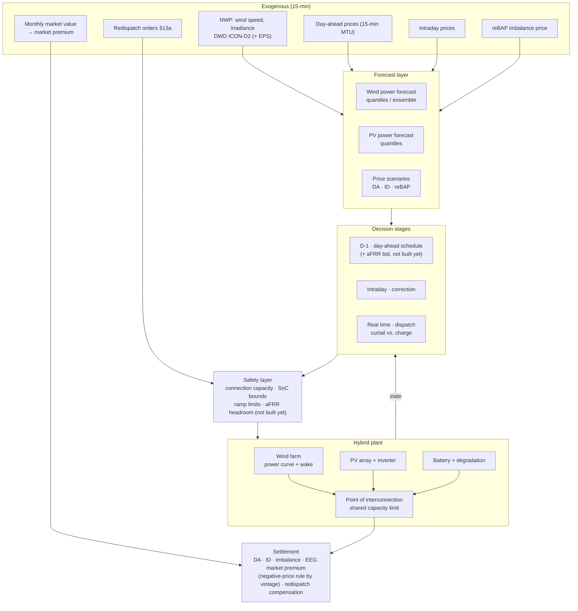

# Project 02 · Utility-Scale Hybrid Wind + PV + Battery Plant Dispatch

**Dispatch of a co-located wind, PV and battery plant behind one grid connection in Germany,
under EEG direct marketing and the negative-price rule of each plant vintage. Evaluated on a
benchmark ladder from B0 (no battery) to B3 (rolling MPC), whose optimisers are linear
programs solved with PuLP and CBC, on Energy-Charts data for the calendar years 2024 and
2025.**

| | |
|---|---|
| **Status** | Ladder B0 to B3 implemented and evaluated; the project stops at B3, on purpose (below). 161 tests, all offline |
| **Method** | B0 no battery · B1 rule-based storage · B2 perfect-foresight LP · B3 rolling LP-MPC on synthetic forecasts |
| **Asset** | 50 MW onshore wind + 30 MWp PV + a 20 MW / 40 MWh battery behind a 60 MW connection; not a real site |
| **Markets** | Day-ahead price and the EEG market premium per technology. Not modelled: intraday trading, a day-ahead schedule settled at reBAP, redispatch. aFRR is not built yet: its settings in `MarketConfig` are inert |
| **Data** | National wind and solar generation, installed capacity and day-ahead prices from Energy-Charts (CC BY 4.0) |
| **Resolution** | 15 min |

> **Project 02 stops at B3, on purpose.** A learned policy is worth training where a rolling
> MPC cannot keep up with the problem, and this model does not pose such a problem yet. Each
> reason can be checked in the code and the tables:
>
> 1. **No rung commits a day-ahead schedule.** `market.settle` prices a deviation from a
>    committed schedule at reBAP, and `baselines.run_ladder` accepts a `schedule`, but no rung
>    produces one and no command passes one. So `imbalance_cost_eur` is 0 in every row of
>    every table.
> 2. **No redispatch.** `market.redispatch_series` exists, but no command calls it or passes
>    an export cap, and `tables.INERT_SETTINGS` names its settings as unused.
> 3. **The connection does not bind on national profiles.** At the plant's 60 MW,
>    `steps_over_connection` is 0 in every Energy-Charts window of
>    [`window_stats.csv`](reports/window_stats.csv). The curtail-or-store decision appears
>    only where the sizing sweep narrows the connection.
> 4. **The premium is deterministic.** It is one realised rate per technology and calendar
>    month or year (`market.premium_table`), and B3 plans on the previous month's realised
>    rate (`market.planning_rates`). No random premium state is left for a policy to learn.
>
> Reinforcement learning is shown in [Project 01](../01-prosumer-pv-bess-mpc-rl/), on a
> household PV battery: a soft actor-critic agent reaches 32.4 % of the gain from B1 to B2
> (median of three seeds), against 89.4 % for its rolling MPC
> ([`rl_summary.csv`](../01-prosumer-pv-bess-mpc-rl/reports/rl_eval_H28/rl_summary.csv)).
> Here, RQ3/H3 and the RL work packages (WP8, WP9) are future work. They become worth doing
> once every rung commits a day-ahead schedule that is settled at reBAP.

## 0. Results

Every result in this section comes from a committed CSV in [`reports/`](reports/).
[`reports/SOURCE.md`](reports/SOURCE.md) says how the set was run, on which data and under
which licence.

### Key results

B2 knows prices and generation in advance, so its figures are upper bounds.

- **The battery's own value** (B2 minus B2 without a battery) rises with every step of
  connection size in both years: from 1,094,990 EUR at 20 MW to 1,240,768 EUR at 60 MW in
  2024, and from 1,298,361 to 1,462,929 EUR in 2025. Curtailing at low prices, which needs no
  battery, adds 124,552 to 139,331 EUR in 2024 and 138,351 to 150,355 EUR in 2025.
- **The 60 MW connection never binds** on national profiles, in either year. There, B1 earns
  exactly what B0 earns, and the connection limit changes the battery's value by 0. A 30 MW
  connection changes it by -32,376 EUR in 2024 and -37,755 EUR in 2025 (-2.7 % and -2.6 %).
  On these data the battery's value is arbitrage.
- **B3**, the deployable rolling MPC, recovers 94.1 % (January 2025) and 95.4 % (July 2025)
  of the gain from B1 to B2, which here is the gain from B0 to B2. It plans on the previous
  month's realised premium, 0.00 and 27.34 EUR/MWh, and is settled on 1.48 and 8.74 EUR/MWh.
- **Every tightening of the negative-price rule** lowers B0's revenue and raises the energy
  B2 chooses to curtail, for both vintages in both years. Under the rule of the newest
  plants, B2 curtails 6,715 MWh in 2024 and 8,155 MWh in 2025 at the default plant.
- **No row of any table** breaks a plant limit, settles any imbalance or buys grid energy:
  each is 0 in every row.

### Reproduce

```bash
pip install -e ".[dev]" && python -m pytest tests/ -q   # 161 tests, offline
python -m hybrid.cli report                     # every table below, in series: about an hour
python -m hybrid.cli report --only sizing_2024  # one table, by the name of its CSV
```

`report` runs each command below and adds `--out reports/<table>.csv` to it. Beside the
tables it writes [`window_stats.csv`](reports/window_stats.csv) (per window: prices,
generation and whether the connection binds) and [`run_meta.csv`](reports/run_meta.csv) (per
table: commit, versions, input hashes, sources and wall time). The data come from
Energy-Charts through the repository's `datakit`, which caches every response; no key is
needed.

How each table is made (the commands `report` ran, as `run_meta.csv` records them):

| Table | Window, Berlin time | Command |
|---|---|---|
| [`sizing_2024.csv`](reports/sizing_2024.csv) | calendar year 2024 | `python -m hybrid.cli sizing --year 2024 --full-year` |
| [`sizing_2025.csv`](reports/sizing_2025.csv) | calendar year 2025 | `python -m hybrid.cli sizing --year 2025 --full-year` |
| [`decompose_2024.csv`](reports/decompose_2024.csv) | calendar year 2024 | `python -m hybrid.cli decompose --year 2024 --full-year` |
| [`decompose_2024_conn-30.csv`](reports/decompose_2024_conn-30.csv) | calendar year 2024 | `python -m hybrid.cli decompose --year 2024 --full-year --conn 30` |
| [`decompose_2025.csv`](reports/decompose_2025.csv) | calendar year 2025 | `python -m hybrid.cli decompose --year 2025 --full-year` |
| [`decompose_2025_conn-30.csv`](reports/decompose_2025_conn-30.csv) | calendar year 2025 | `python -m hybrid.cli decompose --year 2025 --full-year --conn 30` |
| [`negprice_2024.csv`](reports/negprice_2024.csv), [`negprice_2024_premium.csv`](reports/negprice_2024_premium.csv) | calendar year 2024 | `python -m hybrid.cli negprice --year 2024 --full-year` |
| [`negprice_2025.csv`](reports/negprice_2025.csv), [`negprice_2025_premium.csv`](reports/negprice_2025_premium.csv) | calendar year 2025 | `python -m hybrid.cli negprice --year 2025 --full-year` |
| [`ladder_2025-01-01_30d.csv`](reports/ladder_2025-01-01_30d.csv) | 1 to 30 January 2025 | `python -m hybrid.cli ladder --year 2025 --start 01-01 --days 30` |
| [`ladder_2025-07-01_30d.csv`](reports/ladder_2025-07-01_30d.csv) | 1 to 30 July 2025 | `python -m hybrid.cli ladder --year 2025 --start 07-01 --days 30` |
| [`b3_ablation_synthetic_demo.csv`](reports/b3_ablation_synthetic_demo.csv) | 3 synthetic days | `python -m hybrid.cli b3-ablation --synthetic-demo` |

A calendar year runs from midnight on 1 January to midnight on the next 1 January, Berlin
time. The ladder tables also read 2024: B3's price-forecast error is sized on the 2024
day-ahead price, and in the January window B3 plans on December 2024's premium.

### Windows

The plant has 80 MW installed (50 MW wind + 30 MWp PV) behind 60 MW; the synthetic days run
it behind 40 MW. The largest combined capacity factor is the peak generation over the 80 MW.
Quarter-hours are counted as such: from 1 October 2025 the day-ahead price is set per
quarter-hour, so the 2025 count is not four times a count of hours.

Windows of the tables ([`window_stats.csv`](reports/window_stats.csv)):

| Window, Berlin time | Quarter-hours | Mean day-ahead price EUR/MWh | Quarter-hours with a negative price | Peak generation MW | Largest combined capacity factor | Connection MW | Quarter-hours above the connection |
|---|---:|---:|---:|---:|---:|---:|---:|
| calendar year 2024 | 35,136 | 78.51 | 1,828 | 42.5 | 0.531 | 60 | 0 |
| calendar year 2025 | 35,040 | 89.32 | 2,299 | 38.3 | 0.479 | 60 | 0 |
| 1 to 30 January 2025 | 2,880 | 113.24 | 56 | 35.3 | 0.442 | 60 | 0 |
| 1 to 30 July 2025 | 2,880 | 87.87 | 48 | 25.4 | 0.318 | 60 | 0 |
| 3 synthetic days | 288 | 70.14 | 2 | 79.9 | 0.999 | 40 | 183 |

### 0.1 Connection size: the battery and curtailing at low prices (RQ2)

`sizing` sweeps the connection from 20 to 60 MW with the battery fixed. B0 has no battery and
curtails only what the connection forces. "B2 no battery" is B2 with the battery taken out:
perfect foresight that can only curtail. So B2 minus B0 splits into two parts that add up:
**the battery's own value** (B2 minus B2 no battery) and **curtailing at low prices** (B2 no
battery minus B0), which needs no battery. Every row runs the rule of the newest plants
(`new_2025`) and the default plant's annual premium (0.3).

Connection sweep, calendar year 2024 ([`sizing_2024.csv`](reports/sizing_2024.csv)):

| Connection MW | Overbuild | B0 EUR | B1 EUR | B2 EUR | The battery's own value EUR | Curtailing at low prices EUR | B0 forced curtailment MWh |
|---|---:|---:|---:|---:|---:|---:|---:|
| 20 | 4.00 | 7,343,890 | 7,520,155 | 8,563,432 | 1,094,990 | 124,552 | 9,525 |
| 25 | 3.20 | 7,602,732 | 7,673,426 | 8,909,720 | 1,171,509 | 135,479 | 3,701 |
| 30 | 2.67 | 7,713,324 | 7,739,659 | 9,060,224 | 1,208,392 | 138,508 | 1,079 |
| 40 | 2.00 | 7,761,498 | 7,761,820 | 9,137,629 | 1,236,800 | 139,331 | 6 |
| 60 | 1.33 | 7,761,582 | 7,761,582 | 9,141,681 | 1,240,768 | 139,331 | 0 |

Connection sweep, calendar year 2025 ([`sizing_2025.csv`](reports/sizing_2025.csv)):

| Connection MW | Overbuild | B0 EUR | B1 EUR | B2 EUR | The battery's own value EUR | Curtailing at low prices EUR | B0 forced curtailment MWh |
|---|---:|---:|---:|---:|---:|---:|---:|
| 20 | 4.00 | 7,334,501 | 7,485,124 | 8,771,213 | 1,298,361 | 138,351 | 5,458 |
| 25 | 3.20 | 7,475,060 | 7,523,341 | 9,004,543 | 1,383,379 | 146,104 | 1,675 |
| 30 | 2.67 | 7,515,130 | 7,524,704 | 9,090,011 | 1,425,174 | 149,708 | 292 |
| 40 | 2.00 | 7,521,764 | 7,521,764 | 9,129,478 | 1,457,359 | 150,355 | 0 |
| 60 | 1.33 | 7,521,764 | 7,521,764 | 9,135,049 | 1,462,929 | 150,355 | 0 |

The battery's own value rises with every step of connection size in both years: a tight
connection holds back the battery's discharge along with the plant's export, and that costs
more than the spill it lets the battery store is worth (0.2). Where no generation exceeds the
connection, B1 earns exactly what B0 earns, because B1 only stores spill. The tables show
revenue, not an optimum: the project models no cost for the connection or the battery.

### 0.2 Where the battery's value comes from (RQ1)

`decompose` runs the plant at its connection as built and at 200 MW, which nothing reaches.
With no spill to store, the battery's value at 200 MW is arbitrage: the plant's own energy
sold at better prices. The difference is the connection limit's effect: the spill the battery
stores, net of the discharge the limit holds back.

The battery's value by connection ([`decompose_2024.csv`](reports/decompose_2024.csv), [`decompose_2024_conn-30.csv`](reports/decompose_2024_conn-30.csv), [`decompose_2025.csv`](reports/decompose_2025.csv), [`decompose_2025_conn-30.csv`](reports/decompose_2025_conn-30.csv)):

| Year | Connection as built MW | The battery's value as built EUR | The battery's value at 200 MW EUR | Connection limit's effect EUR | Share of the value as built |
|---|---:|---:|---:|---:|---:|
| 2024 | 60 | 1,240,768 | 1,240,768 | 0 | 0.0 % |
| 2024 | 30 | 1,208,392 | 1,240,768 | -32,376 | -2.7 % |
| 2025 | 60 | 1,462,929 | 1,462,929 | 0 | 0.0 % |
| 2025 | 30 | 1,425,174 | 1,462,929 | -37,755 | -2.6 % |

At 60 MW the effect is 0 by construction, because the connection never binds. 30 MW is the
widest connection of the sweep that the plant's generation exceeds in both years, and there
the effect is negative. On national profiles the battery earns from arbitrage, not from
storing spill. Forecast-error management, the third source in H1, needs a schedule settled at
reBAP, which no rung commits.

### 0.3 The negative-price rule by vintage (RQ4)

**The premium.** The law pays each technology max(0, applicable value - market value) on its
own export, wherever the premium is payable. Plants commissioned or awarded before 2023 are
paid against the technology's monthly market value; plants commissioned and, if tendered,
awarded from 2023 on, against its annual value (EEG 2023 Anlage 1 Nr. 2). The model pays the
plant one blended rate per period, the two premiums weighted by its own available generation
in the window (`market.premium_table`). The market values are computed proxies: the
day-ahead price weighted by national generation (Anlage 1 Nr. 3.3, 4.3). The premium is
legally settled on the values the TSOs publish, which this project does not load.
`market.market_values` expects the proxy to run high, so the premiums run low; no committed
data measures by how much.

There are two vintages. The **recent** one is the default plant of every other table: its
applicable values are 73.5 EUR/MWh for wind and 68.0 for PV, the 2024/2025 tender ceilings
that `MarketConfig` cites, not an award, and it is paid against the annual market value. The
**older** one, at 95.0 and 90.0 EUR/MWh against the monthly value, is a sensitivity.

Premium by vintage, the mean over the year's quarter-hours ([`negprice_2024.csv`](reports/negprice_2024.csv), [`negprice_2025.csv`](reports/negprice_2025.csv); by month in [`negprice_2024_premium.csv`](reports/negprice_2024_premium.csv), [`negprice_2025_premium.csv`](reports/negprice_2025_premium.csv)):

| Year | Vintage | Market value | Wind market value EUR/MWh | PV market value EUR/MWh | Wind premium EUR/MWh | PV premium EUR/MWh | Plant rate EUR/MWh | No premium for |
|---|---|---|---:|---:|---:|---:|---:|---|
| 2024 | AW 73.5 (recent onshore) | annual | 64.44 | 46.29 | 9.06 | 21.71 | 11.77 | none |
| 2024 | AW 95.0 (older vintage) | monthly | by month | by month | 31.09 | 34.09 | 33.55 | PV in 2024-11, PV in 2024-12 |
| 2025 | AW 73.5 (recent onshore) | annual | 77.37 | 45.87 | 0.00 | 22.13 | 5.23 | wind in 2025 |
| 2025 | AW 95.0 (older vintage) | monthly | by month | by month | 18.93 | 32.03 | 24.55 | PV in 2025-01, wind in 2025-02, PV in 2025-02, PV in 2025-11, PV in 2025-12 |

**The rules, as implemented** (`market.vintage_rules`; `market.py` cites the statute texts).
A plant's vintage is its commissioning date or, for a tendered plant, the bid date of its
tender where EEG § 100 says so. `none` always pays the premium. The rules from `six_hour` to
`three_hour` remove it for the whole run of negative prices once the run lasts that many
hours. Runs are counted in calendar hours, and an hour counts as negative when the mean of its
quarter-hour prices is negative (§ 100 (45) EEG 2023). `new_2025` removes the premium in every
negative period. The threshold of the vintage from 2023 to 24 February 2025 falls by calendar
year: four hours in 2023, three in 2024 and 2025, two in 2026 and one from 2027. Not
modelled: the § 51a extension of the support period and the small-plant exemptions of
§ 51 (2).

Negative-price rule, calendar year 2024 ([`negprice_2024.csv`](reports/negprice_2024.csv)):

| Rule | Plants that carry it in 2024 | Recent: B0 EUR | Recent: B2 EUR | Recent: B2 chosen curtailment MWh | Older: B0 EUR | Older: B2 EUR | Older: B2 chosen curtailment MWh |
|---|---|---:|---:|---:|---:|---:|---:|
| `none` | before 2016 | 7,878,022 | 9,176,077 | 1,982 | 10,318,068 | 11,543,553 | 377 |
| `six_hour` | 2016-2020 | 7,808,365 | 9,157,002 | 4,762 | 10,090,622 | 11,429,260 | 4,632 |
| `four_hour` | 2021-2022 | 7,777,455 | 9,144,622 | 6,387 | 9,992,663 | 11,372,768 | 6,387 |
| `three_hour` | 2023 to 24 Feb 2025 | 7,768,887 | 9,142,287 | 6,660 | 9,964,021 | 11,362,787 | 6,660 |
| `new_2025` | from 25 Feb 2025 | 7,761,582 | 9,141,681 | 6,715 | 9,940,599 | 11,360,790 | 6,715 |

Negative-price rule, calendar year 2025 ([`negprice_2025.csv`](reports/negprice_2025.csv)):

| Rule | Plants that carry it in 2025 | Recent: B0 EUR | Recent: B2 EUR | Recent: B2 chosen curtailment MWh | Older: B0 EUR | Older: B2 EUR | Older: B2 chosen curtailment MWh |
|---|---|---:|---:|---:|---:|---:|---:|
| `none` | before 2016 | 7,584,010 | 9,143,413 | 3,208 | 9,655,042 | 11,140,539 | 223 |
| `six_hour` | 2016-2020 | 7,539,912 | 9,137,448 | 6,829 | 9,336,133 | 10,956,994 | 6,506 |
| `four_hour` | 2021-2022 | 7,527,595 | 9,135,679 | 7,856 | 9,242,621 | 10,911,640 | 7,792 |
| `three_hour` | 2023 to 24 Feb 2025 | 7,523,655 | 9,135,125 | 8,113 | 9,216,531 | 10,903,216 | 8,053 |
| `new_2025` | from 25 Feb 2025 | 7,521,764 | 9,135,049 | 8,155 | 9,205,646 | 10,902,358 | 8,074 |

B1 equals B0 in every row, because the 60 MW connection never binds, so the tables leave it
out. Each row runs one rule on both vintages, as a sensitivity. Under the statute the older
vintage (monthly value, so dated before 2023) carries `none`, `six_hour` or `four_hour`, and
the recent vintage carries `three_hour` or `new_2025`. No plant carried `new_2025` before
25 February 2025, so on the prices before that day its row is a counterfactual.

B0 cannot react, so its loss from `none` to a rule is the premium the rule removes. B2
curtails more with every tightening and loses less than B0 to every rule. Part of that is
curtailing, which needs no battery; `negprice` runs no "B2 no battery", so the tables do not
split the two. Two approximations of the settlement favour storage (section 11): the rule
applies at the step of export, so energy charged during a suspension earns the premium when
it is sold later, and one blended premium rate per period misprices the steps the rule acts
on. Read B0's loss minus B2's loss as an upper bound on what storage and curtailing recover.

### 0.4 B3 on real data: two 30-day windows of 2025

B3 re-solves the LP every quarter-hour over the next 24 hours on synthetic forecasts
(section 11) and applies the first step; it knows the current quarter-hour exactly. It plans
each month on the previous month's realised premium rate: December 2024's in the January
window and June 2025's in the July window. Every rung is settled on the realised annual
market value of 2025, at the plant's rate for the window's own wind/PV mix.

B3 on 30 days of real data ([`ladder_2025-01-01_30d.csv`](reports/ladder_2025-01-01_30d.csv), [`ladder_2025-07-01_30d.csv`](reports/ladder_2025-07-01_30d.csv)):

| Window, Berlin time | B0 EUR | B1 EUR | B2 EUR | B3 EUR | B3's share of the B1-to-B2 gain | Premium settled on EUR/MWh | Premium B3 planned on EUR/MWh |
|---|---:|---:|---:|---:|---:|---:|---:|
| 1 to 30 January 2025 | 909,598 | 909,598 | 1,001,522 | 996,142 | 94.1 % | 1.48 | 0.00 |
| 1 to 30 July 2025 | 554,183 | 554,183 | 656,969 | 652,211 | 95.4 % | 8.74 | 27.34 |

The connection never binds in either window, so B1, which only stores spill, earns exactly
what B0 earns, and the gain from B1 to B2 is really the gain from B0 to B2. B3 recovers most
of it, although in July it plans on a premium far above the one it is settled on. B3's solve
times are in the CSVs (`b3_solve_time_*`); four runs shared a 4-core laptop, so they give an
order of magnitude only.

### 0.5 B3 against a terminal value, on synthetic inputs

Every input of this table is synthetic, from `hybrid.synthetic`: the portfolio showcase's
three days of wind, PV and price shapes, the default plant behind a 40 MW connection, B3 on a
12-hour horizon, and one fixed premium of 8 EUR/MWh for every rung. It crosses B3's forecast
error with a linear terminal value on the energy stored at the end of each plan.

B3 ablation on synthetic inputs ([`b3_ablation_synthetic_demo.csv`](reports/b3_ablation_synthetic_demo.csv)):

| Forecast error | Terminal value | B0 EUR | B1 EUR | B2 EUR | B3 EUR | B3's share of the B1-to-B2 gain | Energy B3 holds at the end MWh |
|---|---|---:|---:|---:|---:|---:|---:|
| 0 % | off | 190,105 | 197,153 | 198,625 | 198,625 | 100.0 % | 2.0 |
| 0 % | on | 190,105 | 197,153 | 198,625 | 195,058 | -142.4 % | 34.3 |
| 15 % | off | 190,105 | 197,153 | 198,625 | 198,435 | 87.1 % | 2.0 |
| 15 % | on | 190,105 | 197,153 | 198,625 | 194,517 | -179.1 % | 38.0 |

Under perfect forecasts and without a terminal value, B3 matches B2. With the linear terminal
value B3 falls below B1, and it ends the window holding energy it never sells. That is why
the terminal value is off by default (`baselines.default_terminal_price`).

### 0.6 Defects the ladder invariant caught

No rung may beat B2, perfect foresight, on revenue before imbalance, beyond the solver's
rounding (`ladder_tolerance_eur` in every table). `baselines.run_ladder` raises otherwise.

**The market value was once derived from the plant's own export.** A controller that
correctly curtails during negative prices concentrates its output in high-price hours. That
raised its own apparent market value and cut its own premium, so perfect foresight scored
below a do-nothing baseline. The market value is a national figure that one plant cannot
move; it is now exogenous. The invariant then covered B3 only; it now covers every rung,
which would have caught this at once.

**Two B3 defects** surfaced when the portfolio showcase first printed live numbers, on
19 September 2026:

1. **Plan execution.** B3 applied the curtailment fraction it planned on forecast generation
   to the true generation, and so discarded energy the connection could have taken. It now
   executes planned curtailment only where the effective price is negative; elsewhere the
   connection limit alone caps the export.
2. **Terminal value.** A linear value on end-of-horizon storage made B3 hoard energy and lose
   to B1 (0.5). A linear terminal value pushes storage to a bound, because its slope is right
   at one state of charge only. If one is ever needed, it should be concave and depend on the
   state of charge. Project 01 shows the same effect.

`test_rolling_mpc_beats_the_rule_based_baseline` asserts that B3 beats B1 on a synthetic
window. Curtailment is also classified by cause: what the connection would force anyway is
*forced*, and only the rest is *chosen*. Before, every curtailment a plan asked for counted
as chosen, including what the connection forced.

> **Principal caveat on this dataset.** Wind and PV are national capacity factors, far
> smoother than any single site. Their largest combined factor stays well below 1 (Windows),
> so a connection at 75 % of the installed 80 MW never binds and the curtailment problem this
> project is about hardly arises. That is why the sweep runs down to 20 MW, a quarter of the
> installed capacity. On site-level data the curve would sit further right and curtailment
> would be larger. Site-level generation data is the top acquisition priority.

---

## 1. Background and motivation

Co-location is the dominant new build pattern in Germany: wind and PV behind a shared grid
connection point, increasingly with a battery. The economics are driven by a fact that
single-technology analyses cannot capture - the connection capacity is deliberately
**undersized** relative to the sum of the nameplate ratings, because wind and PV peaks rarely
coincide. That undersizing is the source of both the value and the difficulty.

The resulting control problem has four interacting features:

**A shared, binding connection constraint.** When wind and PV do peak together, something must
give: curtail, or charge the battery. The choice depends on price, state of charge, forecast
and remuneration regime - and it recurs thousands of times a year.

**A discontinuous revenue function.** Under EEG direct marketing the plant earns the market
price plus the market premium - except during negative prices, where the premium is suspended
under `§51 EEG` as tightened by the 2025 Solarspitzengesetz for new plants. The optimal action
in a negative-price quarter-hour is qualitatively different from the optimum a minute earlier,
and depends on the plant's commissioning vintage.

**Forecast error is the dominant risk.** The plant commits a quarter-hourly schedule day-ahead
and is exposed to reBAP on the deviation. With ~80 MW of weather-driven capacity, forecast
error, not arbitrage skill, sets the variance of the result. This is where the battery earns
much of its keep - and where a distributional policy should beat a point-forecast MPC.

**The schedule can be overridden.** Under Redispatch 2.0 the plant is subject to
network-operator instruction. The controller must distinguish ordered from self-chosen
curtailment because they settle differently, and must remain feasible after an override.

**Relationship to the author's other work.** This project is the *generic, public-data*
utility-scale counterpart to the applied industrial thesis work; it uses no company data and
is designed so every result is publishable and reproducible from open sources.

---

## 2. Regulatory and market context

| Instrument | How it enters the model |
|-----------|-------------------------|
| **EEG direct marketing** (`§§20 ff. EEG`) | Revenue = market price + market premium (applicable value − monthly market value). The premium's monthly reference makes the objective non-separable across the month - a detail the MILP must handle correctly |
| **Negative-price rule** (`§51 EEG`, tightened by the 2025 Solarspitzengesetz for new plants) | Premium suspended in negative-price periods; for new plants, per negative quarter-hour, with the remuneration period extended instead. **A vintage switch in the model**, and the reason curtailment becomes rational rather than merely tolerated |
| **Remote controllability** (`§9 EEG`) | Network operator can reduce feed-in and read actual output - the technical basis of the override channel |
| **Redispatch 2.0** (`§§13a, 14c EnWG`) | Plants ≥ 100 kW are subject to redispatch; planning data and forecasts are a regulatory obligation. Ordered curtailment is compensated and accounted separately from self-chosen curtailment |
| **Grid connection capacity** | The hard constraint that defines the co-location problem. Flexible connection agreements (capping feed-in in exchange for faster/cheaper connection) are modelled as a configuration variant |
| **Imbalance settlement / reBAP** | The dominant risk term for a weather-driven portfolio |
| **Balancing markets** | Optional aFRR participation by the battery, subject to prequalification and to reserving headroom that then cannot be used for curtailment avoidance. **Not built yet:** the aFRR settings in `MarketConfig` are inert, and no command reads them |
| **Storage regulatory treatment** | Whether the battery may charge from the grid or only from co-located generation materially changes both the optimisation and the EEG treatment. **A switchable configuration**, because the answer determines the business case |

---

## 3. Scope and objectives

### In scope

- A 15-minute co-located hybrid plant model: wind turbines with power curves and wake losses,
  PV with an inverter model, a battery with efficiency and degradation, and a shared
  connection point.
- Full benchmark ladder: B0 historical, B1 rule-based, B2 perfect foresight, B3 rolling MPC,
  plus a learned policy.
- Day-ahead scheduling, intraday correction and imbalance exposure, with the EEG market
  premium correctly modelled including its monthly reference.
- Curtailment decisions distinguishing self-chosen from ordered.
- Battery sizing and connection-capacity sizing sensitivity - the design question a developer
  actually asks.
- Optional aFRR participation and its opportunity cost against curtailment avoidance (not built yet; its settings are inert).

### Out of scope

- Wake-steering and turbine-level control (backlog item **B3**).
- Grid connection studies and detailed power quality.
- PPA structuring and hedging strategy (a natural extension, noted).
- Long-term investment appraisal beyond the sizing sensitivity above.

### Objectives

1. Quantify the value of co-location plus storage against separate operation of the same
   assets, under German rules.
2. Determine the optimal degree of connection undersizing, and how it shifts with battery size
   and with the negative-price regime.
3. Establish how much of the battery's value comes from **forecast-error management** versus
   **arbitrage** versus **curtailment avoidance** - a decomposition rarely reported, and the
   one that matters for sizing.
4. Test whether a distributional learned policy beats a tuned MPC where the imbalance tail
   dominates.
5. Quantify the economic effect of the negative-price rule tightening, by plant vintage.

---

## 4. Research questions and hypotheses

| # | Research question | Hypothesis |
|---|-------------------|-----------|
| RQ1 | Where does the battery's value in a hybrid plant actually come from? | H1: Forecast-error management and curtailment avoidance dominate pure arbitrage at realistic German connection ratios; the ordering reverses only at high connection headroom |
| RQ2 | What is the optimal connection-capacity ratio? | H2: Well below the sum of nameplates, with the optimum shifting **upward** as the negative-price rule tightens (curtailment becomes cheap, so firm export capacity is worth less) |
| RQ3 | Does a learned policy beat rolling MPC? | H3: Yes, modestly, and specifically in high-forecast-error periods, by managing imbalance-tail risk that a point-forecast MPC ignores |
| RQ4 | What does the tightened negative-price rule cost a new plant relative to an old one? | H4: Material, and partly recoverable by storage - quantifying "partly" is the deliverable |
| RQ5 | Is aFRR participation worth it for the battery? | H5: Only when the connection is not the binding constraint; where curtailment risk is high, reserved headroom is too expensive. Not testable yet: aFRR is not built |

---

## 5. System architecture



---

## 6. Problem formulation

### 6.1 Plant model

Wind: turbine power curve with air-density correction and a wake model at farm level,
driven by NWP wind speed with a fitted bias correction. PV: plane-of-array irradiance,
temperature-dependent module model and inverter clipping (`pvlib`). Battery: charge/discharge
efficiency, SoC bounds, C-rate limits, and throughput-plus-rainflow degradation priced at a
configurable €/kWh. Point of interconnection: a hard export limit and, where relevant, an
import limit governing whether the battery may charge from the grid.

### 6.2 MILP (B2 / B3)

**Objective** - maximise
```
Σ_t [ π_DA(t)·s_DA(t)·Δt                       day-ahead schedule revenue
      + π_ID(t)·s_ID(t)·Δt                     intraday adjustment
      − π_reBAP(t)·(g(t) − s(t))·Δt            imbalance settlement (signed)
      + MP(t)·g_EEG(t)·Δt                      market premium, suspended when π_DA(t) < 0
                                               per the applicable vintage rule
      − c_deg·(p_ch(t)+p_dis(t))·Δt ]          degradation
```
subject to: generation availability `g_wind(t) ≤ ĝ_wind(t)`, `g_pv(t) ≤ ĝ_pv(t)` with explicit
curtailment variables; battery energy balance and mutual exclusion of charge/discharge; **the
point-of-interconnection export limit**; ramp limits; reserved headroom where aFRR capacity is
sold (aFRR is not built yet); and a terminal value function on SoC.

The market premium's dependence on the **monthly** market value couples the whole month, so
the rolling-horizon formulation carries a month-to-date accumulator as a state variable rather
than treating each horizon independently - a correctness detail that a naive B3 would get
wrong, weakening the baseline.

### 6.3 MDP formulation (RL)

| Element | Definition |
|---------|-----------|
| **State** | Battery SoC; committed schedule for the remaining horizon; realised generation; wind/PV forecast quantiles over the horizon (and their spread - the uncertainty signal); price forecasts for DA/ID/reBAP; month-to-date market-value accumulator; redispatch state; calendar features |
| **Action** | Battery power setpoint; curtailment level per technology; intraday trade volume; optional aFRR capacity offer at the bid gate, once aFRR is built |
| **Reward** | Step economic result including the correct premium treatment, minus degradation. **No hard-constraint penalties** |
| **Risk** | Distributional critic; CVaR option on the daily result - the imbalance tail is the whole point |
| **Safety layer** | Projection enforcing the export limit, SoC bounds, ramp limits, aFRR headroom reservation (once aFRR is built) and any active redispatch order. Violations impossible by construction |
| **Episode** | 14-30 days, so the monthly premium coupling is visible within an episode |
| **Algorithm** | SAC for continuous dispatch; PPO where the aFRR bid decision is discretised, once aFRR is built |

---

## 7. Data requirements

| Data | Purpose | Source | Resolution | Status |
|------|---------|--------|-----------|--------|
| Wind speed & direction (NWP + reanalysis) | Wind generation and its forecast | **DWD ICON-D2 / ICON-EU**, ICON-D2-EPS for quantiles; ERA5 for long history | 15 min - 1 h | Open |
| Irradiance & temperature | PV generation | DWD; PVGIS; ERA5 | 15 min - 1 h | Open |
| Turbine power curves | Wind conversion | Manufacturer curves / open turbine databases | - | Open |
| Reference plant configuration | Asset definition | **MaStR** (real German co-located sites, capacities, locations, vintages) | - | Open |
| Day-ahead & intraday prices | Revenue | SMARD / ENTSO-E / Energy-Charts | 15 min | Open |
| reBAP | Imbalance settlement | netztransparenz.de | 15 min | Open |
| Monthly market values & applicable values | EEG market premium | netztransparenz.de / BNetzA published values | Monthly | Open |
| Redispatch measures | Override channel calibration | netztransparenz.de | Per measure | Open |
| Balancing capacity prices | Optional aFRR revenue (aFRR not built yet) | `regelleistung.net` | Per 4-h product | Open |
| Battery parameters | Storage model | Manufacturer data + published ageing models | - | Open |
| Realised plant generation | B0/B1 validation | ENTSO-E / SMARD aggregate by technology; site-level only with an operator partner | 15 min | Aggregate open; **site-level is the gap** |

**Validation strategy without site data.** With no site-level metered generation, the B1
validation gate is run against *aggregate* German wind and PV generation: the modelled fleet,
driven by the same NWP, must reproduce the national aggregate profile within stated tolerance.
This validates the weather-to-power chain, which is the dominant error source, while the
plant-specific configuration remains a documented assumption.

---

## 8. Baselines and evaluation

| Rung | Instantiation |
|------|--------------|
| **B0** | Realised operation of an equivalent unhybridised portfolio: wind and PV marketed separately with no storage, at the same site and year |
| **B1** | Standard commercial practice: day-ahead schedule from a point forecast, battery on a simple curtailment-avoidance rule, no intraday optimisation. **Validation gate** |
| **B2** | Perfect-foresight MILP over the evaluation period |
| **B3** | Rolling-horizon MILP-MPC with month-to-date premium accumulator, realistic issue-time forecasts, re-solved every 15 min, tuned |
| **RL** | Distributional SAC/PPO with safety layer, identical forecasts |

**Primary KPI:** annual net revenue (€/a), with mean, 5 %-quantile and CVaR₅ of the daily
distribution. **Headline:** B3-gap closure. **Secondary:** revenue decomposition (DA / ID /
imbalance / premium / aFRR once built), curtailed energy split into self-chosen and ordered, imbalance
volume and cost, battery equivalent full cycles, connection-limit violations (must be 0).

Ablations: connection capacity ratio sweep (the sizing question); battery size sweep;
negative-price rule by vintage; forecast quality (perfect / realistic / degraded / ensemble
vs. point - this is the H3 test); aFRR participation on/off once aFRR is built; grid-charging permitted or not;
storage degradation cost; safety layer on/off.

The **value decomposition** (RQ1) is obtained by re-running the optimal policy with individual
value sources disabled - no imbalance exposure, no curtailment risk, no arbitrage - and
attributing the differences.

---

## 9. Deliverables

1. An open 15-minute German hybrid-plant environment with correct EEG market-premium
   mechanics - including the negative-price vintage switch and the monthly market-value
   coupling, both of which are usually simplified away.
2. A benchmark-ladder implementation (B0-B3) that is reusable for any co-located plant study.
3. A distributional RL controller with a connection-capacity safety layer.
4. The **battery value decomposition** - forecast-error management vs. curtailment avoidance
   vs. arbitrage - which is the result a developer sizing a hybrid plant actually needs.
5. A connection-sizing sensitivity study under the current and previous negative-price regimes.
6. A written report suitable for conference submission.

---

## 10. Work packages and roadmap

| WP | Content | Depends on | Output |
|----|---------|-----------|--------|
| WP1 | Weather-to-power chain: NWP ingestion, wind and PV conversion, bias correction | - | `src/model`, validation vs. aggregate |
| WP2 | Market data pipeline: DA, ID, reBAP, market values, redispatch, balancing | - | `data/processed` |
| WP3 | Plant model incl. battery, degradation, point of interconnection | WP1 | `src/model` |
| WP4 | Settlement module: EEG premium with vintage switch and monthly accumulator, imbalance, redispatch compensation | WP2 | `src/market` |
| WP5 | B0 + B1 + **validation gate** against aggregate generation | WP1, WP3, WP4 | Validation report - **gate** |
| WP6 | Probabilistic wind/PV forecast layer with true issue times (shared with Project 06) | WP1 | `src/forecast` |
| WP7 | MILP B2 + B3 rolling MPC with month-to-date coupling, tuned | WP3, WP4, WP6 | Strong baseline |
| WP8 | Gymnasium environment + safety layer | WP3, WP6 | `src/envs`, `src/safety` |
| WP9 | Distributional RL training, seeds | WP8 | Trained policies |
| WP10 | Evaluation, sizing sweeps, value decomposition, report | WP7, WP9 | `reports/` |

---

## 11. Assumptions and limitations

| Dimension | Core Assumption | Engineering Justification and Reference | Modeling Limitation and Impact |
|---|---|---|---|
| **Physical** | Co-located 40 MW wind, 40 MW PV, and 20 MW / 40 MWh BESS behind a single 40 MW point of connection (POC); linear battery throughput wear (0.015 EUR/kWh). | Represents dominant new utility-scale renewable buildout in Germany; captures structural curtailment from deliberate over-planting. | Omits detailed wake interaction dynamics between wind turbines and temperature-dependent inverter clipping. |
| **Market** | Price-taker on EPEX Spot Day-Ahead market; negative price subsidy cut rules (EEG Section 51 / Section 51a) applied by vintage. | Reflects standard direct marketing arrangements for German renewable parks without speculative merchant bidding. | Omits continuous intraday trading updates (SIDC) and order-book depth constraints during rapid ramping events. |
| **Data** | 15-minute German wind and PV generation profiles derived from national aggregate feeds (Energy-Charts / SMARD) scaled to plant rating; 2024-2025 DE-LU spot prices. | Transparent open-data pipeline ensuring 100% independent auditability without proprietary park SCADA exports. | National aggregate profiles are smoother than single-site telemetry; actual on-site curtailment will be higher than modeled. |
| **Regulatory** | Grid connection capacity hard ceiling (POC limit); EEG Section 51 zero-subsidy rules for consecutive negative hours; Redispatch 2.0 interface. | Fully reflects statutory German Renewable Energy Sources Act (EEG 2021/2023/2025) and EnWG Section 13a dispatch rules. | Note on ancillary service extensions: afrr_enabled is declared for planned balancing market co-optimization extensions and is not yet implemented in the active continuous LP/MILP dispatch model. |

### Operational Risks and Mitigations

| Risk | Mitigation |
|------|-----------|
| No site-level generation data for validation | Weather-to-power chain validated against national aggregate; plant configuration documented as an assumption and swept |
| Price-taker assumption | Reasonable at this plant size; stated explicitly |
| Intraday modelled at index level, not order book | Liquidity and spread modelled parametrically; the sensitivity to that parameterisation is reported |
| MPC may win | Legitimate outcome; the sizing and value-decomposition results are method-independent and stand regardless |
| Regulatory vintage rules complex and evolving | Encoded as explicit switches; the comparison across vintages is a headline result rather than a risk |
| Wake and power-curve modelling error | Bias correction fitted and reported; sensitivity to the wake model included |

---

## 12. Repository structure

Follows [`../../templates/project-template/`](../../templates/project-template/); conventions
in [`../../docs/05-tech-stack.md`](../../docs/05-tech-stack.md). The forecast layer is shared
with [Project 06](../03-probabilistic-forecast-to-bid/).

---

## 13. References

- EEG 2023 `§§9, 20 ff., 51`; the 2025 Solarspitzengesetz amendments; `§§13a, 14c EnWG`
  (Redispatch 2.0) - see [`../../docs/01-german-market-regulatory-primer.md`](../../docs/01-german-market-regulatory-primer.md).
- Marktstammdatenregister; netztransparenz.de published market values.
- `pvlib`, open turbine power-curve databases, DWD ICON model documentation.
- The hybrid/co-located plant dispatch literature, against which the contribution here is the
  correct German remuneration mechanics and the battery value decomposition.

---

## 14. Collaboration

Most valuable contributions: site-level metered generation and schedule/imbalance data from a
German co-located plant (even historical), which would convert the B1 gate from an aggregate
check into a true site validation; and a review of the market-premium settlement modelling by
a direct marketer. Enquiries via the issue tracker.
