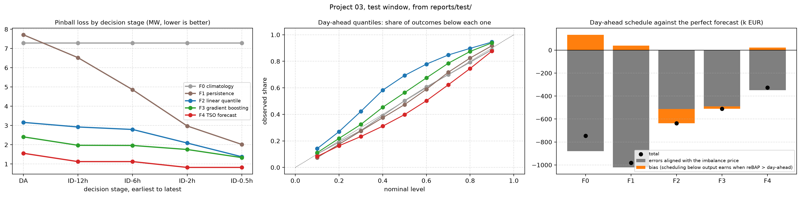

# Project 03 · Probabilistic Forecast-to-Bid for a German Wind and PV Portfolio

A balance responsible party sells the output of a wind and PV portfolio in the day-ahead
auction, may correct the position intraday as forecasts improve, and settles whatever is
left at the German imbalance price, the reBAP. This project forecasts that output from weather
forecasts as they were known at the time, compares the forecasts with the transmission
system operators' published one, and measures what each is worth in that chain at real
2024 to 2026 prices.

Every number below comes from a committed CSV: `reports/test/` for the test window
(1 January to 14 October 2026 UTC, evaluated once, with every setting frozen beforehand) and
`reports/validation/` for the validation window (2 July to 29 December 2025 UTC). Section 6
has the commands.

## 0. Results

**Forecast skill is real, stable across windows and seeds, and short of the published
forecast.** At the day-ahead gate closure, LightGBM (F3) has a pinball loss of 2.41 MW against
7.29 MW for climatology and 7.71 MW for persistence, and its three seeds agree to within
0.013 MW. The forecast the TSOs publish (F4) is better at every decision stage: 1.56 MW at
day-ahead, 0.82 MW half an hour before delivery, against 1.33 MW for F3. The day-ahead
ranking F4 < F3 < F2 < F0, F1 is the same in both windows; half an hour before delivery the
linear model catches up with LightGBM, and in the validation window passes it.
[forecast_by_stage](reports/test/forecast_by_stage.csv)

**Whether that skill pays in euros changes with the window, and the difference stays within
the noise.** Scheduling each forecast day-ahead and settling the rest at reBAP, the 2026 test
window ranks the euros exactly as the skill: TSO forecast 28.96 M EUR, LightGBM 28.78 to
28.79 M, linear 28.65 M, climatology 28.54 M, persistence 28.31 M (Spearman +1.0). The second
half of 2025 does not (-0.4): climatology earned most and the TSO forecast least. In neither
window does any forecast's day-ahead gain over climatology have a 90 % block-bootstrap
interval that excludes zero; for the TSO forecast in 2026 it is +420,171 EUR (-106,521 to
+1,233,049).
[policies](reports/test/policies.csv), [value_of_forecast](reports/test/value_of_forecast.csv),
[quality_vs_value](reports/test/quality_vs_value.csv)

**Why.** For a day-ahead schedule `f`, the result against a perfect forecast is exactly
`sum((y - f) * (reBAP - DA)) * dt`. It splits into a bias part, which pays a schedule below
the output (the portfolio ends long and sells its surplus at reBAP) while reBAP averages above
the day-ahead price (it did, by 4.31 and 4.42 EUR/MWh in the two windows), and an alignment
part, which charges every error that runs with the system's
imbalance. This portfolio is the German fleet in miniature, so the errors of a good forecast
are the system's own errors: the TSO forecast's error correlates more strongly with the spread
between reBAP and the day-ahead price than any other rung's (-0.1611 and -0.0650). In 2026 the
size of the errors decided; in late 2025 climatology's large errors happened to run almost
independently of that spread (-0.0165) while scheduling below the output earned it 96,233 EUR.
Climatology
carries 129,432 MWh of imbalance in the test window, about 40 % of what the portfolio
produced and nearly five times the TSO forecast's;
no balance responsible party may schedule that way, so its euros are a warning about scoring
forecasts in euros alone, not a strategy. [error_alignment](reports/test/error_alignment.csv)

**Trading every forecast revision intraday does not pay.** Policy B1, which follows each
revision at the intraday index, loses money against scheduling once with every forecast that
revises (climatology never does) in both windows at any half-spread from 0.5 EUR/MWh. With the TSO forecast and LightGBM it loses
in 2026 even at a zero half-spread, where only the impact charge of 0.02 EUR/MWh per MW traded
remains: -87,261 EUR and -24,494 EUR (median of three seeds, -18,586 to -30,053). The deadband
rule B3, which trades only large revisions, gains at most 18,258 EUR (persistence, 2026, at a
zero half-spread) and loses 58,322 to 79,902 EUR with the TSO forecast in 2026. [liquidity](reports/test/liquidity.csv)



---

## 1. Setup

### Portfolio and data

| | Source | Use |
|---|---|---|
| Output | German wind (onshore + offshore) and solar public feed-in, Energy-Charts, 15 min, divided by the month's installed capacity (wind, PV AC) and scaled to 200 MW wind + 100 MW PV | the quantity forecast and settled |
| TSO forecasts | day-ahead, intraday and current forecasts of the same fleet, Energy-Charts (transparency platform), scaled the same way | F4, a benchmark |
| Weather | Open-Meteo previous-runs archive at the 16 state capitals and two offshore clusters: wind at 100 m, irradiance, cloud cover, temperature, as forecast one and two days ahead | features of F2 and F3 |
| Day-ahead price | DE-LU, Energy-Charts; hourly products until 2025-09-30, quarter-hourly after | day-ahead revenue |
| Intraday price | ID AEP, netztransparenz.de: the volume-weighted price of the last 500 MW traded in continuous intraday for each quarter-hour | every intraday trade |
| Imbalance price | reBAP, netztransparenz.de, quality-assured; short and long are equal in every quarter-hour downloaded ([SOURCE](data/raw/netztransparenz/SOURCE.md)) | imbalance settlement |

[data_coverage](reports/data_coverage.csv) lists the first and last value of every series and
its missing share per window. The two timestamp conventions agree: forecast irradiance and
measured PV correlate best at lag 0 (0.9833), forecast wind and measured wind too (0.8175)
([data_alignment](reports/data_alignment.csv)).

### Decision stages

Every quarter-hour is decided at the day-ahead gate closure, 12:00 Europe/Berlin on the day
before delivery (a lead of 12 to 35.75 hours, 36.75 on the 25-hour day when the clocks go
back; 23.9 on average), and again at four intraday
stages 12, 6, 2 and 0.5 hours before delivery, never before the intraday market opens at
16:00 the day before. `stages.py` turns timestamps into these decision times; the policies
receive the forecasts and never choose an issue time themselves.

### Settlement and policies

The day-ahead position earns the day-ahead price, each intraday trade the ID AEP minus a
half-spread of 3 EUR/MWh that doubles toward the last stage plus 0.02 EUR/MWh per MW traded,
and what is left settles at reBAP. One price applies to short and long imbalance.

| Policy | Rule |
|---|---|
| B0 day-ahead only | schedule the day-ahead median, never correct |
| B1 intraday to median | trade to the newest median at every intraday stage |
| B3 deadband intraday | trade only the part of a revision beyond `k` times the stage's q90 - q10 band; `k` from the validation window ([frozen_config](reports/frozen_config.json): 4 for F1 to F3, 1 for F4) |
| NV newsvendor fractile | an ablation: schedule a quantile chosen from imbalance-cost asymmetry (0.533, from training data). With one imbalance price for both directions the critical-fractile argument has no basis |
| REF zero imbalance | schedule the realised output: the perfect forecast, not an upper bound |
| CEIL perfect speculation | perfect knowledge of output and prices, 75,581,957 EUR in 2026; no balance responsible party may trade this way |

### The forecast ladder

| Rung | Model |
|---|---|
| F0 climatology | quantiles of the output by calendar month and local hour |
| F1 persistence | wind as last measured, PV as on the last measured day, plus residual quantiles by hour |
| F2 linear quantile | linear quantile regression on 16 aggregate features |
| F3 gradient boosting | LightGBM, one model per quantile level, all features, three seeds |
| F4 TSO forecast | the published forecast plus residual quantiles by hour |

Each rung predicts nine quantiles, 0.1 to 0.9, of the portfolio's capacity factor for each
decision stage. A row for delivery step `t` decided at step `i` sees measured output up to one
hour before `i`, the newest weather run already published at `i` (a run is taken as public six
hours after it was made, so leads to 18 h use the one-day-old run and leads to 42 h the
two-day-old one), and the calendar and sun position of `t`. A test corrupts everything outside
that set and requires identical features.

The split is by delivery time: training from 2024-02-18 (the archive's wind at 100 m starts in
mid-February 2024, irradiance, cloud and temperature in January), validation from 2025-07-02,
test from 2026-01-01, with gaps of at least 36 hours between the windows. The last
60 days of each training window are held out: F3 stops early there, and F2 and F3 shift each
quantile level so that those days are covered as nominal. The validation window tunes only
B3's band. The test window was evaluated once; `backtest --phase test` refuses to overwrite
it.

---

## 2. Results in detail

### 2.1 Forecast quality

Pinball loss in MW by decision stage, test window (27,544 quarter-hours), F3 the median of its
three seeds:

| Rung | DA | ID-12h | ID-6h | ID-2h | ID-0.5h | MAE DA | share below q10 / q50 / q90 (DA) | bias DA |
|---|---:|---:|---:|---:|---:|---:|---|---:|
| F0 climatology | 7.29 | 7.29 | 7.29 | 7.29 | 7.29 | 18.80 | 0.10 / 0.50 / 0.89 | -4.38 |
| F1 persistence | 7.71 | 6.53 | 4.86 | 2.98 | 2.02 | 19.61 | 0.07 / 0.47 / 0.92 | -1.30 |
| F2 linear quantile | 3.16 | 2.92 | 2.79 | 2.09 | 1.38 | 8.37 | 0.14 / 0.69 / 0.95 | +4.11 |
| F3 gradient boosting | 2.41 | 1.97 | 1.96 | 1.75 | 1.33 | 6.02 | 0.11 / 0.56 / 0.94 | +0.65 |
| F4 TSO forecast | 1.56 | 1.13 | 1.13 | 0.82 | 0.82 | 3.92 | 0.08 / 0.40 / 0.88 | -0.71 |

F3 cuts the day-ahead error of the naive rungs to a third. Its day-ahead median sits slightly
high (56 % of outcomes fall below it, calibration error 0.048); half an hour before delivery
its calibration error is 0.008 to 0.010. The recalibration slice works for
F3 but not for the linear model: fitted on November and December, F2's day-ahead shift
overshoots in 2026 (bias +4.11 MW), and fitted on May and June it undershot in late 2025
(-4.46 MW): a linear model's bias moves with the season. F4 has only three forecast vintages,
so ID-12h equals ID-6h and ID-2h equals ID-0.5h; its residual quantiles, fitted on 2024 and
2025, sit low in 2026, when the published forecast ran 0.71 MW under the output.
Validation window: [forecast_by_stage](reports/validation/forecast_by_stage.csv).

### 2.2 Value in the market

Net EUR, test window:

| Rung | B0 day-ahead only | B1 intraday to median | B3 deadband | imbalance MWh (B0) | B0 gain over F0, 90 % CI |
|---|---:|---:|---:|---:|---|
| F0 climatology | 28,543,017 | 28,543,017 | 28,543,017 | 129,432 | |
| F1 persistence | 28,307,894 | 27,316,645 | 28,303,220 | 135,041 | -235,123 (-701,358 to +437,447) |
| F2 linear quantile | 28,652,784 | 28,048,815 | 28,651,998 | 57,628 | +109,767 (-332,790 to +889,433) |
| F3 seed 0 | 28,779,407 | 28,482,071 | 28,779,388 | 41,552 | +236,390 (-161,711 to +821,033) |
| F3 seed 1 | 28,790,925 | 28,481,131 | 28,790,780 | 41,460 | +247,908 (-148,184 to +834,640) |
| F3 seed 2 | 28,790,914 | 28,486,907 | 28,790,610 | 41,392 | +247,897 (-150,597 to +833,981) |
| F4 TSO forecast | 28,963,188 | 28,783,168 | 28,894,076 | 26,989 | +420,171 (-106,521 to +1,233,049) |
| REF zero imbalance | 29,289,862 | | | 0 | |

The same table for the validation window has the TSO forecast at 15,055,372 EUR and
climatology at 15,295,413, every B0 gain over climatology negative, and every B0 interval
again containing zero. [policies](reports/validation/policies.csv),
[value_of_forecast](reports/validation/value_of_forecast.csv). The intervals resample whole
weeks of delivery days ([daily_net](reports/test/daily_net.csv)), so weather spells stay
together.

### 2.3 Why euros do not simply follow skill

Day-ahead schedule against the perfect forecast, split exactly into bias and alignment
(LightGBM shown for its first seed, so that the row adds up;
[validation](reports/validation/error_alignment.csv), [test](reports/test/error_alignment.csv)):

| Rung | corr. of error and reBAP - DA, val. / test | bias part, val. / test | alignment part, val. / test | total, val. / test |
|---|---|---|---|---|
| F0 climatology | -0.0165 / -0.0382 | +96,233 / +133,473 | -185,311 / -880,318 | -89,078 / -746,845 |
| F1 persistence | -0.0281 / -0.0403 | +5,857 / +39,539 | -319,523 / -1,021,507 | -313,666 / -981,968 |
| F2 linear quantile | -0.0725 / -0.0513 | +83,547 / -125,095 | -289,112 / -511,983 | -205,565 / -637,078 |
| F3 seed 0 | -0.0886 / -0.0607 | -1,144 / -19,927 | -310,780 / -490,528 | -311,925 / -510,455 |
| F4 TSO forecast | -0.1611 / -0.0650 | -2,935 / +21,685 | -326,184 / -348,359 | -329,119 / -326,674 |

Scheduling below the output, so that the portfolio ends long, earns where reBAP averages above
the day-ahead price, which it did in both windows. Every error is charged where it runs with the
system: being long while the system is
long settles at a low reBAP. A better forecast has smaller errors, but its remaining errors
are the market's errors, because everyone forecasts the same weather; for this fleet-shaped
portfolio they correlate with the spread more strongly than any other rung's, in both
windows. In 2026 the TSO forecast's errors were nevertheless small enough to give it the
smallest alignment part. What a forecast is worth in euros is therefore the product of error
size, alignment and the spread's volatility, and over half a year that product is noisy.

### 2.4 Intraday correction and liquidity

B1 against B0, EUR, by intraday half-spread; the impact charge of 0.02 EUR/MWh per MW traded
applies in every column, 0 included ([test](reports/test/liquidity.csv),
[validation](reports/validation/liquidity.csv)):

| | 0 | 0.5 | 1 | 3 | 6 EUR/MWh |
|---|---:|---:|---:|---:|---:|
| F4 TSO forecast, test | -87,261 | -102,721 | -118,181 | -180,019 | -272,777 |
| F3 seed 0, test | -18,586 | -65,045 | -111,503 | -297,336 | -576,085 |
| F4 TSO forecast, validation | +8,600 | -704 | -10,008 | -47,224 | -103,047 |
| F3 seed 0, validation | -15,580 | -46,103 | -76,627 | -198,720 | -381,861 |

A likely reason, not tested here: the forecast revisions are public, so by the time they are
traded the intraday price already carries them, and settling every trade at the ID AEP, an
index of the last trades before delivery, builds that in. Persistence is the exception at a
zero half-spread (+57,592 EUR in validation, +20,602 in 2026): its day-ahead forecast is so
poor that correcting it is worth something, though not at 0.5 EUR/MWh. The band of B3, tuned to the validation window, does not transfer: with the TSO
forecast it loses 69,112 EUR against B0 in 2026 at 3 EUR/MWh, and for F1 to F3 the widest band
on offer won, so B3 hardly trades at all.

### 2.5 What did not survive the change of window

The validation window alone suggested that climatology beats every forecast in euros and that
following the TSO forecast's revisions intraday pays at a half-spread close to zero. Neither
holds in 2026. What holds in both: the day-ahead forecast ranking, the exact bias and
alignment split, the TSO forecast's errors correlating most strongly with the spread, B0 gains
whose intervals contain zero, and B1 losing money from a half-spread of 0.5 EUR/MWh with every
forecast that revises.

---

## 3. Errors found and fixed in this rebuild

The earlier version of this README (before commit ac498d6) reported that B3 beat B1 by
286,110 EUR in 30 days of 2025. That number came from a model in which intraday trading could
not earn anything, and it is withdrawn.

1. **The intraday price was the day-ahead price and the imbalance price was synthetic** (spot
   plus noise, independent of the portfolio's errors). Both are now the published series.
2. **The forecasts were the realised output plus noise of a hand-set size**, with an
   independent error per lead time, so every revision was fresh noise. The ladder in section 1 replaced them; the noise model remains only as a
   labelled ablation (`synthetic-*` commands), now with nested errors and a spread that uses
   only past data.
3. **Day-ahead positions used forecasts issued after the 12:00 gate closure** for every
   quarter-hour delivered after noon (a fixed 24-hour lead). Decision times now come from
   timestamps.
4. **The look-ahead audit could not fail**: it only re-checked the store's own guard. It now
   counts forecasts read after their decision time, and a test shows it catches a cheating
   stage. In the backtest every forecast is issued at its decision time by construction, so
   there the audit can only catch a stage that decides after delivery; that the forecasts use
   no data from after their decision time is what the information-set test of fix 9 checks.
5. **The forecast store answered a lead beyond its horizon with another quarter-hour's
   forecast.** It raises now.
6. **The newsvendor fractile was fitted on the window it was scored on**, and the synthetic
   imbalance price shared a random generator with the forecast store.
7. **"CRPS" was twice the mean pinball over the levels 0.1 to 0.9**, biased against the real
   CRPS; the scores now report the pinball loss under its own name.
8. **"B3 stochastic MPC" was a deadband rule** with one hand-set parameter. It is named as one.
9. Found while building: **the PV seasonal-persistence feature wrapped around to the end of the
   series** for the first day of data, i.e. read the future. The information-set test caught
   it.
10. **LightGBM first stopped early on the validation window itself**, which left it biased and
    overconfident on the window it was scored on. It now stops early and recalibrates on
    held-out training days.

Every fix that changes behaviour (1 to 6, 9 and 10) has a regression test that fails when the
bug is put back; 7 and 8 are renames. The tests for 1 and 10 came later, after a review found
them missing.

## 4. Limits of the evidence

- **The portfolio is the German fleet in miniature.** Its output is far smoother than a real
  300 MW portfolio's, and its forecast errors are the system's errors, which makes the
  alignment part as large as it can be. A real portfolio's own errors would partly run
  against the system and earn.
- **PV is public feed-in**, without self-consumption, because the TSO forecasts forecast
  feed-in; its capacity factor is therefore low.
- **The TSO forecasts carry no publication time.** The EU transparency rules make the
  day-ahead forecast due by 18:00 on the day before delivery, after the 12:00 gate closure,
  so F4 may hold information the other rungs could not have had. It is a benchmark, not a
  competitor.
- **Every intraday trade clears at the ID AEP**, an index of the last trades before delivery.
  A trade decided twelve hours ahead would have met a different price, and the half-spread
  is an assumption, swept from 0 to 6 EUR/MWh.
- **The weather is Open-Meteo's best-match model**, whose composition can change over time,
  and the six-hour publication delay is an assumption.
- **The history is short**: training from February 2024, one validation half-year, one test
  window of 287 days. The validation window contains the switch to quarter-hourly
  day-ahead products on 2025-10-01.
- **reBAP for 15, 16 and 18 October 2026 was still missing** when the test ran (the
  quality-assured series was published up to the 19th with those gaps), which set the end of
  the test window.
- The portfolio is a price taker.

## 5. Not built

Price and reBAP forecasting, decision-focused learning, a reinforcement-learning trading policy,
scenario-based stochastic optimisation and ensemble weather forecasts are not part of this
project. `../../docs/09-learned-forecast-layer.md` records the plan they belonged to and how
the built part departs from it. ICON-D2-EPS has no public archive to test against, and
Open-Meteo's historical-forecast product would leak, because it stitches together the shortest
lead of every run.

## 6. Reproduce

```bash
pip install -e ".[forecast,dev]"
python -m pytest tests -q
python -m f2b.cli build-data                   # Energy-Charts and Open-Meteo, cached
python -m f2b.cli backtest --phase validation  # the slow step: LightGBM with three seeds
python -m f2b.cli backtest --phase test        # once; refuses to overwrite reports/test/
python ../../scripts/make_f2b_figure.py        # the figure, from the committed CSVs
```

reBAP and ID AEP have to be downloaded by hand from netztransparenz.de (pages
"Ausgleichsenergiepreis > reBAP" and "> Index Ausgleichsenergiepreis", time zone UTC, any
number of overlapping files) into `data/raw/netztransparenz/`; the site exports at most about
seven months of reBAP per file. `backtest --reuse-forecasts` revalues the cached forecasts
without refitting. Each `run_meta.json` names the commit that made the forecasts and the one
that valued them.

The parametric-noise ablation keeps its four commands: `synthetic-policies`,
`synthetic-forecast`, `synthetic-score-vs-value` and `synthetic-liquidity`.

## 7. Data and licences

Energy-Charts (Fraunhofer ISE) and Open-Meteo data are CC BY 4.0. reBAP and ID AEP are
published by the four German TSOs on netztransparenz.de; the raw files are not redistributed,
only results derived from them.

## 8. Files

| | |
|---|---|
| `src/f2b/data.py`, `weather.py` | the dataset and the issue-time weather |
| `src/f2b/stages.py` | decision times and the look-ahead audit |
| `src/f2b/features.py`, `models.py` | the information sets, the split and the ladder F0 to F4 |
| `src/f2b/policies.py` | the policies and the settlement |
| `src/f2b/evaluate.py`, `analysis.py`, `pipeline.py` | the backtest and its tables |
| `src/f2b/forecast.py`, `ablation.py` | the forecast store, scoring, and the parametric-noise ablation |
| `reports/` | every CSV this README cites |
